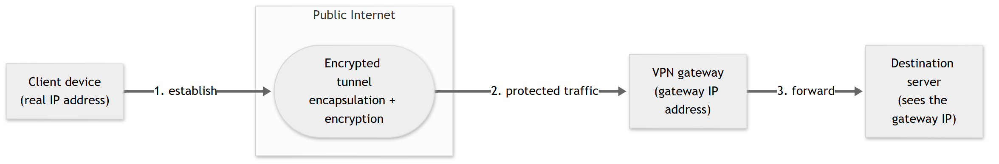
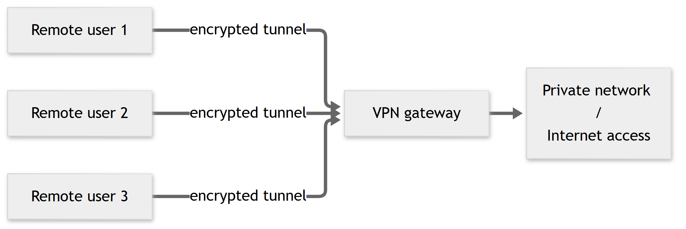
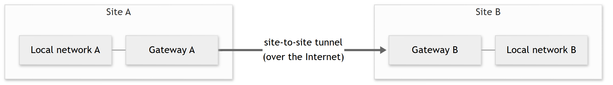

<!--
DRAFT — Chapter II (English Markdown, per P-03: converted to Word at the end).
Numbering follows the supervisor's structure (VPN_Portal_Thesis_Structure.txt): this is CHAPTER II
(the student's early draft mislabelled it "Chapter I"; Chapter I is the host organisation, EADN).
Citation convention (methodology guide): numbered footnotes with full references.
Website footnotes carry the access date (10–11 October 2026); the student adds the exact access time
when finalising, as the guide's example shows. Sources are tracked in docs/memoire/ch2-sources.md.
Figures II.1–II.3 are rendered (docs/memoire/figures/) and inserted.
Mobile elements are marked as POSTPONED (decision D-16).
-->

# CHAPTER II — Overview of VPN Services and E‑commerce

## Introduction

The portal developed in this project sits at the meeting point of two domains: the **Virtual Private Network (VPN)**, which is the service being sold, and **electronic commerce**, which is the mechanism through which that service is offered, paid for and delivered. Designing such a portal therefore requires a clear understanding of both fields, as well as of the security and regulatory constraints that apply to them.

This chapter establishes that theoretical foundation. It first presents the fundamentals of VPNs — their core concepts, architecture and main protocols — before describing the different types of VPN service and the security and compliance requirements they must satisfy. It then turns to electronic commerce: its definition, its business models and the electronic sales process, with particular attention to the Algerian payment context. The chapter continues with the design principles that govern a modern sales portal, relating each principle to the choices made in this work, and closes with a comparative analysis of existing VPN offerings that situates the proposed solution. The concepts introduced here are reused in Chapter III (analysis and design) and Chapter IV (implementation).

## II.1 Fundamentals of VPNs (Virtual Private Networks)

### II.1.1 Core Concepts

A Virtual Private Network is a technology that allows two endpoints to communicate securely across a shared or public network — typically the Internet — as if they were connected by a dedicated private link. This is achieved by *tunnelling*: the original network packets are encapsulated and protected inside an outer, encrypted channel established between the two endpoints.[^nist]

A VPN tunnel provides three core security services:[^nist]

- **Confidentiality** — transmitted data is encrypted, so that a third party intercepting the traffic cannot read it;
- **Integrity** — any alteration of the data in transit can be detected, usually through a message authentication code;
- **Authentication** — each endpoint can verify the identity of the other before exchanging traffic, which prevents impersonation.

A remote-access VPN also has a consequence for privacy: because the user's traffic is routed through the gateway (see II.1.2), the services it reaches observe the gateway's IP address rather than the user's own. This is why VPNs are used both by organisations, to connect remote sites and teleworkers to internal resources, and by individuals, to protect their traffic on untrusted networks such as public Wi-Fi.

### II.1.2 VPN Architecture

In its simplest form, a VPN architecture involves three elements: a **client** (the user's device running VPN software), a **VPN server or gateway** (the endpoint that terminates the tunnel and relays traffic), and the **transit network** (the public Internet that physically carries the encapsulated packets).

Establishing a tunnel follows a consistent sequence, regardless of the protocol used:

1. the client contacts the server and the two parties **authenticate** each other (using keys or certificates);
2. they perform a **key exchange** to derive the symmetric keys that will encrypt the session;
3. an **encrypted tunnel** is established, and application traffic is encapsulated, encrypted and sent through it;
4. the server **decapsulates** the traffic and forwards it to its destination, returning responses through the same tunnel.

**Figure II.1 — Principle of a VPN tunnel.** *Source: author.*

### II.1.3 Common VPN Protocols

A VPN protocol defines how authentication, key exchange and encapsulation are carried out. Three families dominate current practice:

- **IPsec** (Internet Protocol Security) is a suite of protocols standardised by the IETF that secures communication at the network layer. Its architecture is defined in RFC 4301, and key management is handled by IKE (Internet Key Exchange). IPsec is mature and is the traditional choice for site-to-site VPNs, but its configuration is comparatively complex.[^rfc4301][^nist]
- **OpenVPN** is a widely deployed open-source solution that builds the tunnel on top of the TLS/SSL protocol and the OpenSSL library. It is flexible and portable across operating systems.[^openvpn]
- **WireGuard** is a recent protocol designed for simplicity and performance. It uses a small, fixed set of modern cryptographic primitives — static **Curve25519** keys for mutual authentication (in the manner of OpenSSH), **ChaCha20-Poly1305** for authenticated encryption of packets carried over UDP,[^wireguard] and **BLAKE2s** for hashing and keyed hashing[^wgproto] — and its reference implementation is deliberately compact, at *"less than 4,000 lines of code"*, which makes it far easier to audit than its predecessors.[^wireguard]

The **portal developed in this project provisions WireGuard tunnels**: for each entitled subscription it generates a Curve25519 key pair and a ready-to-import configuration file for the official WireGuard client. WireGuard was chosen for its performance, its modern cryptography and the small, auditable code base highlighted above. Table II.1 compares the three protocol families on the criteria most relevant to this choice.

| Criterion | IPsec | OpenVPN | WireGuard |
|---|---|---|---|
| Standardisation / origin | IETF; original architecture 1995 (RFC 1825[^rfc1825]), current RFC 4301 (2005) | Open-source project (OpenVPN Inc.) | Open-source project (J. A. Donenfeld); whitepaper 2017[^wireguard] |
| Network layer | Network layer (IP) | Application layer, over TLS/SSL | Network layer, over UDP |
| Cryptography | Configurable suites (AES, SHA, DH/ECDH) | TLS cipher suites via OpenSSL | Fixed modern set — Curve25519, ChaCha20-Poly1305, BLAKE2s[^wgproto] |
| Code base | Very large | Large | Small ("< 4,000 lines") |
| Configuration | Complex | Moderate | Simple |
| Typical use | Site-to-site, enterprise | Remote access, cross-platform | Remote access and consumer VPNs, high performance |

**Table II.1 — Comparison of the main VPN protocols.** *Source: author, compiled from the cited references.*[^rfc4301][^openvpn][^wireguard]

## II.2 Types of VPN Services

VPNs are usually classified by the kind of endpoints they connect.

### II.2.1 Remote Access VPN

A **remote-access VPN** connects a single user device to a private network or to the Internet through a gateway. The user runs a client application that establishes the tunnel on demand. This model is used by teleworkers who need to reach their organisation's internal resources, and, in the consumer market, by individuals who want to protect their browsing on untrusted networks.

**Figure II.2 — Remote-access VPN.** *Source: author.*

### II.2.2 Site-to-Site VPN

A **site-to-site VPN** connects two entire networks, for example the local networks of two branch offices, over the Internet. The tunnel is established between the gateways of each site rather than on individual devices, so it is transparent to the end users. This model is typically implemented with IPsec and is used to build an organisation-wide intranet or an extranet with partners.[^nist]

**Figure II.3 — Site-to-site VPN.** *Source: author.*

### II.2.3 Client-Server VPN

In the **client-server** model, a dedicated client application installed on the user's device manages the connection to a provider's VPN servers, handling key exchange, encryption and reconnection. This is the model used by commercial VPN providers, where a subscriber installs an application and selects a server to connect to.

The service distributed through the proposed portal follows this **client-server, remote-access** model: customers obtain a WireGuard configuration and connect from their own device to the service's gateways. The portal itself is responsible not for carrying VPN traffic but for *selling* and *provisioning* the service — managing offers, subscriptions, payments and the issuance of VPN credentials.

## II.3 Security and Compliance in VPN Services

### II.3.1 Encryption and Authentication

Encryption is the mechanism that guarantees confidentiality. Two families are combined in practice:

- **Symmetric encryption**, where the same key encrypts and decrypts data, is fast and is used for the bulk of the traffic. Modern VPNs favour **authenticated encryption with associated data (AEAD)** ciphers, such as ChaCha20-Poly1305 or AES-GCM, which provide confidentiality and integrity in a single operation.
- **Asymmetric cryptography**, based on public/private key pairs, is used to authenticate the endpoints and to agree on the symmetric session keys without ever transmitting them in clear. Key agreement typically relies on (elliptic-curve) Diffie–Hellman — WireGuard, for instance, uses Curve25519.[^wireguard]

A desirable property of the key-exchange step is **forward secrecy**: session keys are ephemeral, so that compromising a long-term key does not expose traffic recorded in the past. Authentication itself may rely on pre-shared keys, X.509 certificates or, in WireGuard's case, on the peers' public keys.

### II.3.2 Security Protocols

Beyond the VPN tunnel itself, a VPN **sales portal** also relies on web-security protocols:

- **TLS 1.3** (RFC 8446) secures all communication between the user's browser and the portal, providing encryption, integrity and authentication of the server, with forward secrecy by default.[^rfc8446]
- **IPsec** (RFC 4301) and the VPN protocols discussed in II.1.3 secure the VPN traffic proper.[^rfc4301]

In this project, all browser-to-server exchanges go over HTTPS/TLS, and the application adds further defences at the HTTP layer (security headers, anti-CSRF tokens) that are described in Chapters III and IV.

### II.3.3 Compliance Standards (ISO, GDPR)

A service that handles personal data and payments must respect information-security and data-protection frameworks.

- **ISO/IEC 27001** is the international standard for an Information Security Management System (ISMS); it defines a risk-based set of requirements and controls for protecting the confidentiality, integrity and availability of information.[^iso27001]
- The **General Data Protection Regulation (GDPR, Regulation (EU) 2016/679)** governs the processing of personal data for individuals in the European Union. It establishes principles such as lawfulness, purpose limitation, **data minimisation**, storage limitation, and a set of rights for the data subject (access, rectification, erasure).[^gdpr]
- In Algeria, the protection of personal data is governed by **Law 18-07 of 10 June 2018**, which sets the rules for processing personal data and created the national supervisory authority (ANPDP); it was amended in 2025 by **Law 25-11**.[^law1807]

These frameworks directly shape the design of the portal: the personal data collected is limited to what the service requires (data minimisation); a subscriber can close their account, which erases their personal data while retaining anonymised billing records; and the portal's data model stores no VPN connection or traffic data. The only logging the portal keeps is a security and billing **audit log**, discussed in II.5.4.

## II.4 E-commerce and Sales Portals

### II.4.1 Definition of E-commerce

Several authoritative definitions of electronic commerce coexist, and the present work relies on the Algerian legal definition as primary and on an international definition as complement.

The **OECD** defines an e-commerce transaction as *"the sale or purchase of goods or services, conducted over computer networks by methods specifically designed for the purpose of receiving or placing of orders"*, adding that payment and delivery may take place on- or off-line.[^oecd] The **World Trade Organization**, in its 1998 Work Programme on Electronic Commerce, uses a broader formulation: *"the production, distribution, marketing, sale or delivery of goods and services by electronic means"*.[^wto]

For the Algerian context, **Law 18-05 of 10 May 2018** establishes the legal framework for electronic commerce. Its **Article 6** defines electronic commerce as the activity by which an electronic supplier (*e-fournisseur*) offers or provides to an electronic consumer (*e-consommateur*), remotely and by electronic means of communication, the supply of goods and services; the law's scope is set out in Article 2.[^law1805] This legal grounding is important for the project, since the portal is intended to operate in Algeria and to accept national payment instruments (see II.4.3).

### II.4.2 Online Business Models

Electronic commerce is commonly classified by the nature of the parties involved. Table II.2 summarises the four classic models and indicates where the proposed portal fits.

| Model | Parties | Example | Relevance to the portal |
|---|---|---|---|
| B2C (Business-to-Consumer) | A business sells to individual consumers | Online retail, streaming subscriptions | **Primary model** — individual VPN plans (Essential, Standard) sold to end users |
| B2B (Business-to-Business) | A business sells to another business | Software licences, wholesale | **Secondary model** — the Team plan, a seat-based offer for organisations |
| C2C (Consumer-to-Consumer) | Individuals sell to each other | Classified-ads and marketplace platforms | Not applicable |
| C2B (Consumer-to-Business) | Individuals offer to businesses | Freelancing, influencer services | Not applicable |

**Table II.2 — Classic e-commerce business models.** *Source: author.*

The portal therefore operates mainly as a **B2C** service, with a **B2B** component for team/organisation subscriptions.

### II.4.3 Electronic Sales Processes

The electronic sales process for a service portal generally comprises the following stages: presentation of the **catalogue** (offers and prices), **selection** of an offer by the customer, **order placement**, **payment**, and **delivery**. For a digital service such as a VPN, delivery is dematerialised and immediate: once payment is confirmed, access credentials and configuration are made available to the customer automatically.

In Algeria, online payment relies mainly on two national instruments: the **EDAHABIA** card issued by Algérie Poste and the interbank card **CIB**. Because integrating directly with the national monetary system is heavy for a small service, the project uses the **Chargily Pay** payment gateway, which exposes a developer API and accepts both EDAHABIA and CIB in Algerian dinars (DZD).[^chargily] The security aspects of this integration (hosted checkout, signed webhook, idempotency) are examined in II.5.2 and detailed in Chapter IV.

## II.5 Sales Portal Design Principles

This section presents the principles that govern a well-designed sales portal and relates each one to the choices made in this project.

### II.5.1 UI/UX & Ergonomic Principles

Ergonomics in web design concern usability, accessibility and the overall user experience: the interface should be clear, consistent, responsive across screen sizes, and should guide the user through the purchase with as little friction as possible. The portal's interface is built as a responsive web application and follows these principles; a native mobile client is planned as future work (**POSTPONED — decision D-16**) and is not part of the current scope.

### II.5.2 Payment Security

Handling payments securely is a central requirement of any sales portal. Good practice is to **delegate the collection of card data to a specialised payment gateway** rather than storing it, so that sensitive card details never transit through or rest on the portal's own servers. The integrity of the exchange with the gateway must also be guaranteed: payment notifications (webhooks) should be **cryptographically signed and verified**, and the processing of a payment should be **idempotent**, so that a notification received more than once cannot activate a subscription or charge a customer twice.

The project applies these principles through the Chargily integration: checkout is hosted by the gateway, the webhook is verified with an HMAC-SHA256 signature, and payment handling is idempotent.[^chargily] The corresponding implementation is presented in Chapter IV (§IV.5.2).

### II.5.3 User Rights Management

A portal exposes different capabilities to different users, and must enforce that separation. This is the purpose of **Role-Based Access Control (RBAC)**, combined with the **principle of least privilege**: each user receives only the permissions required by their role. In this project two roles are distinguished — the ordinary **customer** and the **administrator** — and access to administrative functions is enforced on the server as well as at the routing layer. The role-and-permission mapping is detailed in Chapter III.

### II.5.4 Traceability and Auditability

**Traceability** is the ability to record significant actions and events, and **auditability** is the ability to review those records afterwards. Keeping an **audit trail** of security- and billing-relevant events supports accountability, incident investigation and compliance; the OWASP project lists insufficient logging and monitoring among the common weaknesses of web applications.[^owasptop10]

It is important to distinguish two kinds of logging. Recording users' browsing or connection *traffic* would run counter to the data-minimisation principle (II.3.3); a privacy-oriented VPN service is therefore designed not to keep such records (a "zero-log" posture). What the present work implements is on the portal side: the portal's data model stores no VPN connection or traffic data, and the only log it keeps is a security and billing **audit log** of events such as administrative actions, authentication failures and payment state changes. The audit log's structure is described in Chapters III and IV.

## II.6 Competitive Analysis

### II.6.1 Existing Solutions / Competitors

The consumer VPN market is dominated by a small number of global providers that distribute their service through a client-server model and a subscription business model, with applications for the main desktop and mobile operating systems and large networks of servers. Two of the most prominent are **NordVPN** and **Proton VPN**; other well-known providers include ExpressVPN and Surfshark. Table II.3 compares NordVPN and Proton VPN — examined from their official documentation — with the solution proposed in this work.

| Characteristic | NordVPN / Proton VPN (representative global providers) | Proposed portal |
|---|---|---|
| Distribution model | Client-server, subscription | Client-server, subscription |
| Target market | Global | Algeria (local focus) |
| Payment instruments | Credit/debit cards, PayPal, cryptocurrency, Apple Pay / Google Pay; Proton VPN also accepts cash (CHF/USD/EUR) and bank transfer — **neither lists EDAHABIA or CIB**[^nordvpnpay][^protonpay] | **EDAHABIA and CIB, in DZD**, via Chargily[^chargily] |
| Pricing currency | Foreign currencies (USD, EUR, CHF); local currency only in a few listed countries, not Algeria[^protonpay] | **Algerian dinar (DZD)**[^chargily] |
| VPN protocols | WireGuard, OpenVPN and IKEv2 (NordVPN's NordLynx and Proton VPN's Stealth are WireGuard-based)[^nordvpnproto][^protonproto] | WireGuard[^wgproto] |

**Table II.3 — Comparison with two representative global providers.** *Source: author, from the NordVPN and Proton VPN official pages (accessed 11 October 2026).*

### II.6.2 Pros and Cons

Global providers offer undeniable strengths: large server networks, mature and polished applications, and a choice of modern protocols. For an Algerian user, however, their published payment options reveal a concrete limitation: as shown in Table II.3, **neither NordVPN nor Proton VPN lists EDAHABIA or CIB** among its payment methods, and both charge in foreign currencies (Proton VPN's local-currency list does not include Algeria). This is the gap the present project addresses — a VPN sales portal designed for the Algerian market, accepting the national payment instruments in dinars, with a simple purchase and provisioning flow. The analysis of the existing situation at the host organisation, which motivates the project in practical terms, is presented in Chapter I.

## Conclusion

This chapter has established the theoretical foundation on which the rest of the work builds. It introduced the core concepts, architecture and main protocols of VPNs, and justified the choice of WireGuard for the service distributed through the portal. It reviewed the types of VPN service and situated the project within the client-server, remote-access model. It then examined the security mechanisms (encryption, authentication, forward secrecy) and the compliance frameworks (ISO/IEC 27001, GDPR, Algerian Law 18-07) that constrain such a service. On the commercial side, it defined electronic commerce from the Algerian legal and international standpoints, presented the relevant business models and the electronic sales process, and described the national payment context (EDAHABIA and CIB through the Chargily gateway). Finally, it set out the design principles of a sales portal — ergonomics, payment security, rights management and traceability — relating each to the choices made here, and it compared the proposed solution with existing offerings, identifying the local-payment gap that the project fills. The next chapter translates these foundations into a concrete analysis and design of the system.

---

<!--
FIGURES: Figures II.1–II.3 are rendered (docs/memoire/figures/vpn-tunnel.png, vpn-remote-access.png,
vpn-site-to-site.png, Mermaid, scale 3) and inserted above; add them to the List of Figures when assembling the document.
ACCESS DATES: website footnotes show "accessed 10/11 October 2026"; add the exact time when finalising (methodology guide example).
The verbatim text of Article 6 of Law 18-05 should be quoted from the Journal officiel n° 28 in the final version.
Table II.3 was verified from the NordVPN and Proton VPN official pages on 11 October 2026 (payment methods, currencies, protocols); no commercial figure is left for the student to validate.
-->

## Notes

[^nist]: BARKER (Elaine), DANG (Quynh), FRANKEL (Sheila), SCARFONE (Karen), WOUTERS (Paul): *Guide to IPsec VPNs*, NIST Special Publication 800-77 Revision 1, National Institute of Standards and Technology, Gaithersburg (MD), 2020. https://doi.org/10.6028/NIST.SP.800-77r1 (accessed 10 October 2026).
[^wireguard]: DONENFELD (Jason A.): *WireGuard: Next Generation Kernel Network Tunnel*, NDSS Symposium 2017, Internet Society, 2017. https://www.wireguard.com/papers/wireguard.pdf (accessed 10 October 2026).
[^wgproto]: WireGuard: *Protocol & Cryptography* (official protocol page). https://www.wireguard.com/protocol/ (accessed 11 October 2026).
[^openvpn]: OpenVPN Inc.: *OpenVPN — Community Resources (documentation)*. https://openvpn.net/community-resources/ (accessed 10 October 2026).
[^rfc1825]: ATKINSON (Randall): *Security Architecture for the Internet Protocol*, Request for Comments (RFC) 1825, Internet Engineering Task Force (IETF), August 1995 (obsoleted by RFC 2401, then by RFC 4301). https://www.rfc-editor.org/rfc/rfc1825 (accessed 11 October 2026).
[^rfc4301]: KENT (Stephen), SEO (Karen): *Security Architecture for the Internet Protocol*, Request for Comments (RFC) 4301, Internet Engineering Task Force (IETF), 2005. https://www.rfc-editor.org/rfc/rfc4301 (accessed 10 October 2026).
[^rfc8446]: RESCORLA (Eric): *The Transport Layer Security (TLS) Protocol Version 1.3*, Request for Comments (RFC) 8446, Internet Engineering Task Force (IETF), 2018. https://www.rfc-editor.org/rfc/rfc8446 (accessed 10 October 2026).
[^iso27001]: International Organization for Standardization: *ISO/IEC 27001 — Information security, cybersecurity and privacy protection — Information security management systems — Requirements*, ISO, Geneva, 2022. https://www.iso.org/standard/27001 (accessed 10 October 2026).
[^gdpr]: Regulation (EU) 2016/679 of the European Parliament and of the Council of 27 April 2016 on the protection of natural persons with regard to the processing of personal data (General Data Protection Regulation), *Official Journal of the European Union*, L 119, 4 May 2016. https://eur-lex.europa.eu/eli/reg/2016/679/oj (accessed 10 October 2026).
[^law1807]: Loi n° 18-07 du 10 juin 2018 relative à la protection des personnes physiques dans le traitement des données à caractère personnel, *Journal officiel de la République algérienne démocratique et populaire*, n° 34, 10 June 2018 (amended by Loi n° 25-11, *JORADP* n° 48, 24 July 2025).
[^oecd]: Organisation for Economic Co-operation and Development (OECD): *The 2025 OECD Definition of E-commerce and Guidelines for Interpretation* (reaffirming the 2009 definition), OECD Publishing, Paris, 2025. https://www.oecd.org/en/publications/the-2025-oecd-definition-of-e-commerce-and-guidelines-for-interpretation_2254f1de-en.html (accessed 10 October 2026).
[^wto]: World Trade Organization: *Work Programme on Electronic Commerce*, document WT/L/274, WTO, Geneva, 25 September 1998. https://www.wto.org/english/tratop_e/ecom_e/ecom_e.htm (accessed 10 October 2026).
[^law1805]: Loi n° 18-05 du 10 mai 2018 relative au commerce électronique, *Journal officiel de la République algérienne démocratique et populaire*, n° 28, 16 May 2018 (definition of electronic commerce: Article 6; scope: Article 2).
[^chargily]: Chargily: *Chargily Pay — Developer Documentation (v2)*. https://dev.chargily.com/ (accessed 10 October 2026).
[^owasptop10]: OWASP Foundation: *OWASP Top 10 — Web Application Security Risks*. https://owasp.org/www-project-top-ten/ (accessed 10 October 2026).
[^nordvpnpay]: Nord Security: *What payment methods do you accept?* (NordVPN support). https://support.nordvpn.com/hc/en-us/articles/19685782821265 (accessed 11 October 2026).
[^nordvpnproto]: Nord Security: *The NordLynx protocol — the solution for a fast and secure VPN connection* (NordVPN blog). https://nordvpn.com/blog/nordlynx-protocol-wireguard/ (accessed 11 October 2026). Confirms NordLynx is NordVPN's WireGuard-based protocol; NordVPN also offers OpenVPN and IKEv2/IPsec.
[^protonpay]: Proton AG: *Payment methods* (Proton VPN support). https://protonvpn.com/support/payment-options/ (accessed 11 October 2026).
[^protonproto]: Proton AG: *How to change VPN protocols* (Proton VPN support). https://protonvpn.com/support/how-to-change-vpn-protocols/ (accessed 11 October 2026).
