# CHAPTER III — System Analysis and Design

## Introduction

The previous chapter set out the theoretical foundations of VPN services and electronic commerce. This chapter turns to the system itself: it analyses the requirements of the VPN sales portal and presents its design, moving from the actors and their needs down to the data model that the implementation (Chapter IV) is built on.

The analysis and design are expressed with the **Unified Modeling Language (UML)**, the standardised modelling language maintained by the Object Management Group. UML is "a graphical language for visualizing, specifying, constructing, and documenting the artifacts of … systems",[^uml] and it is the de-facto standard for object-oriented analysis and design. Three complementary views are used here, as in most information-system studies:

- the **use-case diagram**, which captures *what* the system does and *who* uses it (actors, use cases and the associations between them, with the «include» and «extend» relationships);
- the **sequence diagram**, which shows *how* a scenario unfolds over time as messages exchanged between participants;
- the **class diagram**, which describes the *structure* of the system — its classes, their attributes and operations, and their relationships.

The chapter follows this order. It first gives an overview of the system and its architecture (III.1), identifies the stakeholders (III.2) and maps their roles and permissions (III.3). It then specifies the use cases in textual form (III.4) and in diagrams (III.5), details the main scenarios with sequence diagrams (III.6), and gives the class diagram (III.7). Finally it presents the data design — the relational model (III.8), the data dictionary (III.9), the business rules (III.10) and the relationships and cardinalities (III.11) — and closes with the project planning (III.12). The models reflect the implemented portal.

## III.1 Project Overview

The portal is a web application that **sells and provisions a VPN service** for the Algerian market. A visitor can browse the offers and prices and send a sales inquiry; after registering, a customer starts a free trial or pays for a subscription with EDAHABIA or CIB through the Chargily gateway, and then downloads a ready-to-use WireGuard configuration. An administrator operates a back-office console that covers accounts, offers, subscriptions, payments, testimonial moderation, sales inquiries and an audit log.

Architecturally, the system separates a **Next.js front end** from a **Laravel REST API**, which communicate over HTTP through a same-origin path (`/backend-api`). The API owns all business logic and data; the front end gates the private areas and forwards calls to the API. Three external services are used: the **Chargily Pay** gateway for payments, an **e-mail** service for verification, receipts and reminders, and a **WireGuard gateway** for the VPN tunnels. Figure III.1 shows this architecture; a native mobile client is planned as future work and would be reached through a token API.

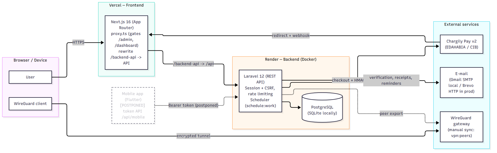

**Figure III.1 — Global architecture of the portal (web; mobile postponed).** *Source: prepared by the authors.*

### III.1.1 Functional Requirements

The portal must let a **visitor** browse the offers, prices and testimonials and send a sales inquiry; let a **customer** register and verify their e-mail, start a seven-day trial once, subscribe to and pay for a plan with EDAHABIA or CIB, download a WireGuard configuration file, consult their billing history and receipts, submit a testimonial, cancel their subscription and manage or close their account; let a **team owner** add and remove members within the seat limit; and let an **administrator** manage accounts, offers, subscriptions, payments and refunds, moderate testimonials, handle sales inquiries and consult the audit log. These functions are specified one by one as use cases in III.4.

### III.1.2 Non-Functional Requirements

Beyond those functions, the portal must satisfy several quality requirements. **Security**: access control enforced on the server, CSRF protection, rate limiting, signed and idempotent payment handling, and VPN private keys encrypted at rest. **Privacy**: data minimisation — no VPN traffic data is stored — together with an audit trail for accountability. **Reliability**: a payment is applied exactly once, and access follows the paid period rather than the subscription status. **Usability**: a responsive interface usable on desktop and phone, with as little friction as possible in the purchase. **Localisation**: an Algerian-market service, with prices in Algerian dinars and the national payment instruments. **Maintainability**: a conventional, well-tested technology stack. These requirements guide the design presented in this chapter and the implementation in Chapter IV.

## III.2 Stakeholder Identification

The analysis distinguishes five **business roles**. In the implemented system these map onto two technical roles — an ordinary **user** (`role = user`) and an **administrator** (`role = admin`) — plus the team roles carried in the membership pivot (`owner` / `member`). Separate technical accounts per business role are future work; today a single `admin` role covers every administrative section, and the split between business roles is reflected by the sections of the admin console each one uses. Table III.1 summarises the mapping.

### III.2.1 System Administrator
Operates the platform at the technical level: manages user accounts (roles, deletion) and consults the audit log. Implemented as the **admin** role (admin → *Accounts*, *Audit log*).

### III.2.2 Sales Manager
Manages the commercial offer: creates and edits the plans shown on the public pricing page, provisions team subscriptions and follows up sales inquiries. Implemented within the **admin** role (admin → *Offers*, *Subscriptions / Team*, *Contact requests*).

### III.2.3 Contract & Billing Manager
Oversees payments and subscriptions: consults payments, records refunds and manages subscription lifecycles. Implemented within the **admin** role (admin → *Payments*, *Subscriptions*).

### III.2.4 Client (Buyer)
The end customer who buys and uses the VPN service: browses offers, subscribes and pays, downloads the VPN configuration, manages their subscription and account, and may own a team. Implemented as the **user** role (and, for a team, the `owner` pivot role).

### III.2.5 Technical Support
Handles customer-facing follow-up: moderates testimonials and answers sales/contact inquiries. Implemented within the **admin** role (admin → *Comments*, *Contact requests*). A full ticketing/helpdesk system is future work; support is provided here through contact requests and moderation.

| Business role | Implemented as | Where in the system |
|---|---|---|
| System Administrator | **Admin** (`role = admin`) | admin → Accounts, Audit log |
| Sales Manager | Admin (Sales view) | admin → Offers, Subscriptions / Team, Contact requests |
| Contract & Billing Manager | Admin (Billing view) | admin → Payments (refunds), Subscriptions |
| Client (Buyer) | **User** (`role = user`) + Team `owner`/`member` | client dashboard, checkout, VPN configuration |
| Technical Support | Admin (Support view) | admin → Contact requests, Comments (moderation) |

**Table III.1 — Mapping of the five business roles to the implemented roles.** *Source: prepared by the authors, from the routes and middleware.*

## III.3 Role and Permission Mapping

Access control is **enforced on the server** by the authenticated session together with the user's role: the `EnsureUserIsAdmin` middleware guards every `/api/admin/*` route, and on the front end `proxy.ts` additionally gates the `/admin` and `/dashboard` areas. Table III.2 gives the resulting permission matrix for the four relevant roles (the *Team member* role has the same client permissions as a user, their VPN access being provided by the team).

| Capability | Visitor | User | Team owner | Admin |
|---|:--:|:--:|:--:|:--:|
| Browse offers / testimonials, send a contact request | ✓ | ✓ | ✓ | ✓ |
| Register / log in | ✓ | — | — | — |
| Start trial / subscribe / pay / download VPN config | — | ✓ | ✓ | ✓ |
| Cancel own subscription, manage own account, view own billing | — | ✓ | ✓ | ✓ |
| Add / remove team members (within the seat limit) | — | — | ✓ | — |
| Manage users / plans / payments / subscriptions / testimonials, view the audit log, provision a team subscription | — | — | — | ✓ |

**Table III.2 — Role / permission matrix (server-enforced by session + role, `EnsureUserIsAdmin`, and `proxy.ts`).** *Source: prepared by the authors, from the routes and middleware.*

## III.4 Use Case Specifications

A **use case** describes a service the system renders to an **actor** (a role interacting with the system) to achieve a goal. Actors are linked to use cases by *associations*; a use case may *«include»* another (a mandatory sub-behaviour) or be *«extended»* by another (an optional/conditional behaviour). Table III.3 lists the actors of the portal. The use cases that follow are described in a standard format (Title, Actor, Description, Pre-condition, Nominal scenario, Alternative scenarios): the ten core client use cases first, then the additional client, administration and team-management use cases that complete the diagrams of III.5.

| Actor | Type | Description |
|---|---|---|
| Visitor | Primary (human) | Unauthenticated user; browses offers and testimonials, and can send a contact request. |
| Client (User) | Primary (human) | Authenticated customer; subscribes, pays, downloads the VPN configuration, manages the subscription and account. |
| Team owner | Primary (human) | A customer who owns a team subscription; manages team members within the seat limit. |
| Administrator | Primary (human) | Staff member operating the back-office console (accounts, offers, billing, moderation, inquiries, audit). |
| Scheduler | Secondary (system) | The server's scheduled tasks (expire subscriptions, send reminders, reconcile pending payments). |
| Chargily Pay | Secondary (external) | The payment gateway: hosted checkout and server-to-server webhook. |

**Table III.3 — Actors of the system.** *Source: prepared by the authors.*

### III.4.1 UC-01 — Authenticate
| | |
|---|---|
| **Title** | Authenticate (register, log in, log out, reset password) |
| **Actor** | Visitor, User |
| **Description** | Create an account (with a 7-day trial on a chosen self-serve plan), sign in, sign out, and reset a forgotten password. |
| **Pre-condition** | A valid e-mail address; for login, an existing account. |
| **Nominal scenario** | The visitor submits their credentials; the server validates them, opens the session and returns the user profile. Registration also sends a verification e-mail. |
| **Alternative scenarios** | Invalid credentials → 401; five failed login attempts for the same e-mail and IP within 60 seconds → throttled (429); an expired CSRF token → 419 (the client refreshes it once and retries). |

**Table III.4 — UC-01: Authenticate.** *Source: prepared by the authors.*

### III.4.2 UC-02 — Browse VPN offers
| | |
|---|---|
| **Title** | Browse VPN offers |
| **Actor** | Visitor, User |
| **Description** | View the active plans with their monthly/yearly prices and the approved testimonials. |
| **Pre-condition** | None. |
| **Nominal scenario** | The front end requests `GET /api/pricing` (active plans, cached) and `GET /api/testimonials` (approved); the offers and testimonials are displayed. |
| **Alternative scenarios** | A load error shows a message with a retry action. |

**Table III.5 — UC-02: Browse VPN offers.** *Source: prepared by the authors.*

### III.4.3 UC-03 — Get the VPN configuration
| | |
|---|---|
| **Title** | Get the VPN configuration |
| **Actor** | User |
| **Description** | Obtain the WireGuard configuration file for an entitled subscription. |
| **Pre-condition** | An active trial or subscription, a verified e-mail, and a configured gateway. |
| **Nominal scenario** | From the dashboard the user clicks "Download WireGuard config"; the server issues a peer (key pair + tunnel address) and returns `nexusvpn.conf`. |
| **Alternative scenarios** | No access → 403; e-mail not verified → 403 (`email_unverified`); gateway not configured → 503 ("servers being set up"). |

**Table III.6 — UC-03: Get the VPN configuration.** *Source: prepared by the authors.*

### III.4.4 UC-04 — Subscribe and checkout
| | |
|---|---|
| **Title** | Subscribe and checkout (one active subscription per user, no cart) |
| **Actor** | User |
| **Description** | Start a paid subscription to a self-serve plan through the payment gateway. |
| **Pre-condition** | Signed in, **e-mail verified**, a self-serve plan chosen. |
| **Nominal scenario** | The user picks a plan and period; `POST /api/checkout` creates a pending payment and a Chargily checkout, and the user is redirected to the hosted payment page. |
| **Alternative scenarios** | E-mail not verified → 403; too many attempts → 429; gateway unreachable → 502. |

**Table III.7 — UC-04: Subscribe and checkout.** *Source: prepared by the authors.*

### III.4.5 UC-05 — Process payment (Chargily)
| | |
|---|---|
| **Title** | Process payment |
| **Actor** | User, Chargily Pay (external) |
| **Description** | Confirm a payment and activate the subscription. |
| **Pre-condition** | A pending checkout. |
| **Nominal scenario** | The user pays on Chargily (EDAHABIA/CIB); the HMAC-signed webhook (and an active verification as a fallback) confirm the payment, which is applied **idempotently**: the subscription is activated, a VPN peer is issued and a receipt is e-mailed. |
| **Alternative scenarios** | Amount/currency mismatch → not activated (`amount_mismatch` / `currency_mismatch`); failed/canceled/expired → the subscription is unchanged; a delayed webhook → the result page polls the verification endpoint. |

**Table III.8 — UC-05: Process payment.** *Source: prepared by the authors.*

### III.4.6 UC-06 — Manage VPN accounts (provisioning & revocation)
| | |
|---|---|
| **Title** | Manage VPN accounts |
| **Actor** | User, Scheduler (system) |
| **Description** | Issue and revoke the WireGuard peer that backs a user's VPN access. |
| **Pre-condition** | — |
| **Nominal scenario** | A peer is issued on the first configuration download; it is revoked automatically when no subscription grants the user access any more (cancellation, expiry, refund, or removal from a team). |
| **Alternative scenarios** | Address pool exhausted → error (not reached in practice). |

**Table III.9 — UC-06: Manage VPN accounts.** *Source: prepared by the authors.*

### III.4.7 UC-07 — View billing history
| | |
|---|---|
| **Title** | View billing history |
| **Actor** | User |
| **Description** | Consult one's past payments and subscriptions. |
| **Pre-condition** | Signed in. |
| **Nominal scenario** | The dashboard shows the paginated payment history and subscription history. |
| **Alternative scenarios** | — |

**Table III.10 — UC-07: View billing history.** *Source: prepared by the authors.*

### III.4.8 UC-08 — View payment receipts
| | |
|---|---|
| **Title** | View payment receipts (receipt view; a PDF invoice is future work) |
| **Actor** | User |
| **Description** | See the details of a payment. |
| **Pre-condition** | Signed in; an existing payment. |
| **Nominal scenario** | "Details" on a payment opens a receipt dialog (reference, plan, amount, status, dates, Chargily checkout id). |
| **Alternative scenarios** | A downloadable PDF invoice is future work. |

**Table III.11 — UC-08: View payment receipts.** *Source: prepared by the authors.*

### III.4.9 UC-09 — Manage subscriptions
| | |
|---|---|
| **Title** | Manage subscriptions |
| **Actor** | User |
| **Description** | Cancel the current subscription (extending or changing a plan is handled through UC-04). |
| **Pre-condition** | A current subscription. |
| **Nominal scenario** | On cancellation, a **trial ends immediately** (access removed, VPN peer revoked) while a **paid period is kept until its end** (access continues, VPN kept). |
| **Alternative scenarios** | No current subscription → 409; a team subscription → managed by the sales team (409). |

**Table III.12 — UC-09: Manage subscriptions.** *Source: prepared by the authors.*

### III.4.10 UC-10 — Contact the company
| | |
|---|---|
| **Title** | Contact the company |
| **Actor** | Visitor / User, Administrator |
| **Description** | Send a sales inquiry for the Team plan, which an administrator then handles. |
| **Pre-condition** | — |
| **Nominal scenario** | The Team inquiry form is submitted and stored (`status = new`); an administrator lists it, marks it handled and provisions a team subscription. |
| **Alternative scenarios** | Validation errors; rate-limit (429). |

**Table III.13 — UC-10: Contact the company.** *Source: prepared by the authors.*

The three use cases below complete the client side (they appear in Figure III.3).

### III.4.11 UC-11 — Verify e-mail
| | |
|---|---|
| **Title** | Verify e-mail |
| **Actor** | User |
| **Description** | Confirm the e-mail address using the link sent at registration. |
| **Pre-condition** | A registered account whose e-mail is not yet verified. |
| **Nominal scenario** | The user opens the signed verification link (`GET /api/email/verify/{id}/{hash}`); the server checks the signature and marks the e-mail verified, which unlocks checkout and the VPN configuration. |
| **Alternative scenarios** | Invalid or expired signature → 403; the link can be re-sent (`POST /api/email/verification-notification`). |

**Table III.14 — UC-11: Verify e-mail.** *Source: prepared by the authors.*

### III.4.12 UC-12 — Manage account
| | |
|---|---|
| **Title** | Manage account |
| **Actor** | User |
| **Description** | Change the e-mail address or password, or permanently delete the account. |
| **Pre-condition** | Signed in; changes require the current password. |
| **Nominal scenario** | In account settings, `PUT /api/account/email` or `PUT /api/account/password` (each requires the current password); `DELETE /api/account` (confirmed with the password and by typing the e-mail) anonymises and soft-deletes the account, keeping anonymised billing history. |
| **Alternative scenarios** | Wrong current password → 422; an administrator cannot self-delete → 409 (`admin_account`); a team owner cannot self-delete → 409 (`team_owner`). |

**Table III.15 — UC-12: Manage account.** *Source: prepared by the authors.*

### III.4.13 UC-13 — Submit a testimonial
| | |
|---|---|
| **Title** | Submit a testimonial |
| **Actor** | User |
| **Description** | Write a testimonial that is shown publicly once approved. |
| **Pre-condition** | Signed in. |
| **Nominal scenario** | `POST /api/testimonials` stores the text as `pending`; it appears on the site after an administrator approves it (UC-18). |
| **Alternative scenarios** | One pending testimonial per user at a time → 429; an hourly rate-limit applies. |

**Table III.16 — UC-13: Submit a testimonial.** *Source: prepared by the authors.*

The use cases below are performed by the **Administrator** in the back-office console (Figure III.4); the last one is performed by a **team owner**.

### III.4.14 UC-14 — Manage user accounts
| | |
|---|---|
| **Title** | Manage user accounts (incl. delete user) |
| **Actor** | Administrator |
| **Description** | Search accounts, change a user's role, and delete an account. |
| **Pre-condition** | An authenticated administrator. |
| **Nominal scenario** | `GET /api/admin/users` (search by name/e-mail, filter by role and subscription); `PATCH /api/admin/users/{user}` (name, e-mail, role); `DELETE /api/admin/users/{user}` → the shared `closeAccount` logic anonymises and soft-deletes the user, revokes VPN access and records the action. |
| **Alternative scenarios** | Cannot delete the last administrator, oneself, or a team owner → 422; cannot remove one's own admin role → 422. |

**Table III.17 — UC-14: Manage user accounts.** *Source: prepared by the authors.*

The self-deletion guard appears in two use cases because two different endpoints are involved: when a user deletes their **own** account (UC-12, `DELETE /api/account`) the guard returns **409**, whereas when an administrator deletes an account from the console (UC-14, `DELETE /api/admin/users/{user}`) it returns **422** — the two responses are therefore consistent, not contradictory.

### III.4.15 UC-15 — Manage offers
| | |
|---|---|
| **Title** | Manage offers |
| **Actor** | Administrator (Sales) |
| **Description** | Create, edit, activate/deactivate and delete the plans shown on the pricing page. |
| **Pre-condition** | An authenticated administrator. |
| **Nominal scenario** | `GET /api/admin/plans`; `POST /api/admin/plans` (create); `PATCH /api/admin/plans/{plan}` (edit, `is_active`); `DELETE /api/admin/plans/{plan}` removes a plan that no subscription references. The pricing cache is flushed so the public page always matches, and each change is audited. |
| **Alternative scenarios** | A plan referenced by subscriptions cannot be deleted → 409 (deactivate it instead). |

**Table III.18 — UC-15: Manage offers.** *Source: prepared by the authors.*

### III.4.16 UC-16 — Manage payments and refunds
| | |
|---|---|
| **Title** | Manage payments and refunds |
| **Actor** | Administrator (Billing) |
| **Description** | Consult payments and record refunds. |
| **Pre-condition** | An authenticated administrator. |
| **Nominal scenario** | `GET /api/admin/payments` (filter by status, search by e-mail); `POST /api/admin/payments/{payment}/refund` (reason, optionally end the subscription) → `recordRefund` marks the payment refunded and audits it. |
| **Alternative scenarios** | A payment that cannot be refunded → 409. |

**Table III.19 — UC-16: Manage payments and refunds.** *Source: prepared by the authors.*

### III.4.17 UC-17 — Manage subscriptions and provision a team subscription
| | |
|---|---|
| **Title** | Manage subscriptions and provision a team subscription |
| **Actor** | Administrator |
| **Description** | Consult subscriptions, cancel one, and provision a team subscription for a customer. |
| **Pre-condition** | An authenticated administrator. |
| **Nominal scenario** | `GET /api/admin/subscriptions`; `POST /api/admin/subscriptions/team` (owner e-mail, plan, seats, months) creates the subscription and the team and attaches the owner; `POST /api/admin/subscriptions/{subscription}/cancel` ends a subscription immediately. |
| **Alternative scenarios** | The owner must have an existing account and no current subscription → 409; cancelling a subscription that is not active → 409. |

**Table III.20 — UC-17: Manage subscriptions and provision a team subscription.** *Source: prepared by the authors.*

### III.4.18 UC-18 — Moderate testimonials
| | |
|---|---|
| **Title** | Moderate testimonials |
| **Actor** | Administrator (Support) |
| **Description** | Review submitted testimonials and approve, reject or delete them. |
| **Pre-condition** | An authenticated administrator. |
| **Nominal scenario** | `GET /api/admin/testimonials` (filter by status); `PATCH /api/admin/testimonials/{id}` (approved / rejected) records the moderator and date; `DELETE /api/admin/testimonials/{id}` removes one. Each action is audited. |
| **Alternative scenarios** | — |

**Table III.21 — UC-18: Moderate testimonials.** *Source: prepared by the authors.*

### III.4.19 UC-19 — Handle contact requests
| | |
|---|---|
| **Title** | Handle contact requests |
| **Actor** | Administrator (Support / Sales) |
| **Description** | Review sales inquiries and mark them handled. |
| **Pre-condition** | An authenticated administrator. |
| **Nominal scenario** | `GET /api/admin/contact-requests` (filter new / handled); `PATCH /api/admin/contact-requests/{id}` (handled) records the handler and date; a team subscription can then be provisioned (UC-17). |
| **Alternative scenarios** | — |

**Table III.22 — UC-19: Handle contact requests.** *Source: prepared by the authors.*

### III.4.20 UC-20 — Consult the audit log
| | |
|---|---|
| **Title** | Consult the audit log |
| **Actor** | Administrator (System Administrator) |
| **Description** | Review the recorded security and billing events. |
| **Pre-condition** | An authenticated administrator. |
| **Nominal scenario** | `GET /api/admin/audit-logs` (filter by event) returns a paginated list — date, event, actor, subject and details. |
| **Alternative scenarios** | — |

**Table III.23 — UC-20: Consult the audit log.** *Source: prepared by the authors.*

### III.4.21 UC-21 — Manage team members
| | |
|---|---|
| **Title** | Manage team members |
| **Actor** | Team owner |
| **Description** | Add or remove members of the team within the seat limit, and rename the team. |
| **Pre-condition** | Signed in as the owner of a team. |
| **Nominal scenario** | `GET /api/team`; `POST /api/team/members` (add by e-mail, within the seats) gives the member their own VPN access; `DELETE /api/team/members/{member}` revokes it; `PATCH /api/team` renames the team. |
| **Alternative scenarios** | All seats in use → 409; the member needs a NexusVPN account; the owner cannot be removed → 422. |

**Table III.24 — UC-21: Manage team members.** *Source: prepared by the authors.*

> **Mobile use cases — placeholder.** When the Flutter client is resumed, the same client use cases (UC-01, UC-03, UC-04, UC-07, UC-09) are reached over the token API `/api/mobile/*`; a dedicated mobile use-case diagram will be added then.

## III.5 Use Case Diagrams

The use cases above are organised into three diagrams: a **global** diagram showing all actors and the main use cases, a **client** diagram for the customer side, and an **administration** diagram for the back office. The separate "support portal" is merged into the administration diagram (contact requests and moderation), so the "support" view (III.5.3) is covered there rather than as a separate portal.

### III.5.1 Global Use Case Diagram
Figure III.2 places the actors — Visitor, User (client), Administrator, the Scheduler and the external Chargily Pay — around the system boundary. It shows one «include» relationship, *Subscribe & checkout* «include» *Process payment*, because completing a purchase always involves the payment step (the external Chargily Pay actor participates in that use case). A verified e-mail is a **pre-condition** of checkout and of getting the VPN configuration — stated in the corresponding use-case tables — not an «extend» relationship.

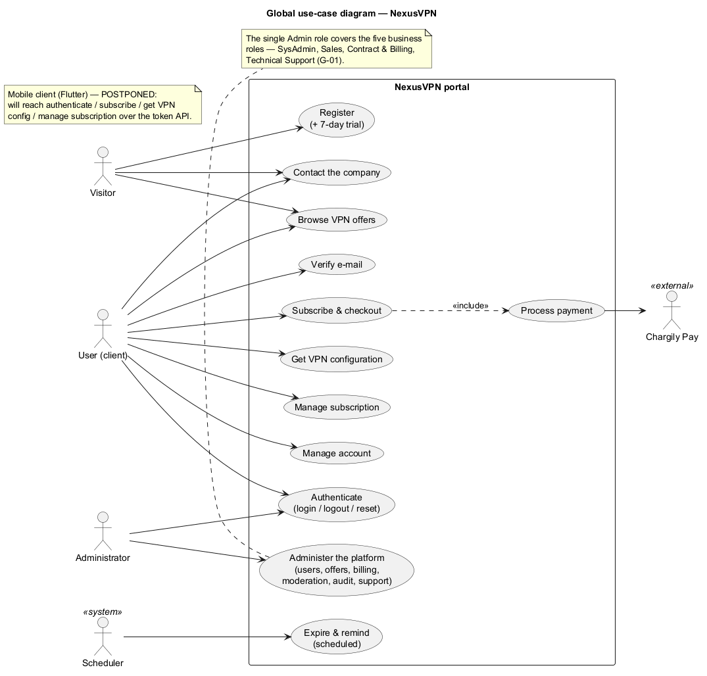

**Figure III.2 — Global use-case diagram.** *Source: prepared by the authors (UML, PlantUML).*

### III.5.2 Client Portal Diagram
Figure III.3 details the client side: authentication, browsing offers, subscribing and paying, downloading the VPN configuration, viewing billing and receipts, managing the subscription and account, and — for a team owner — managing team members.

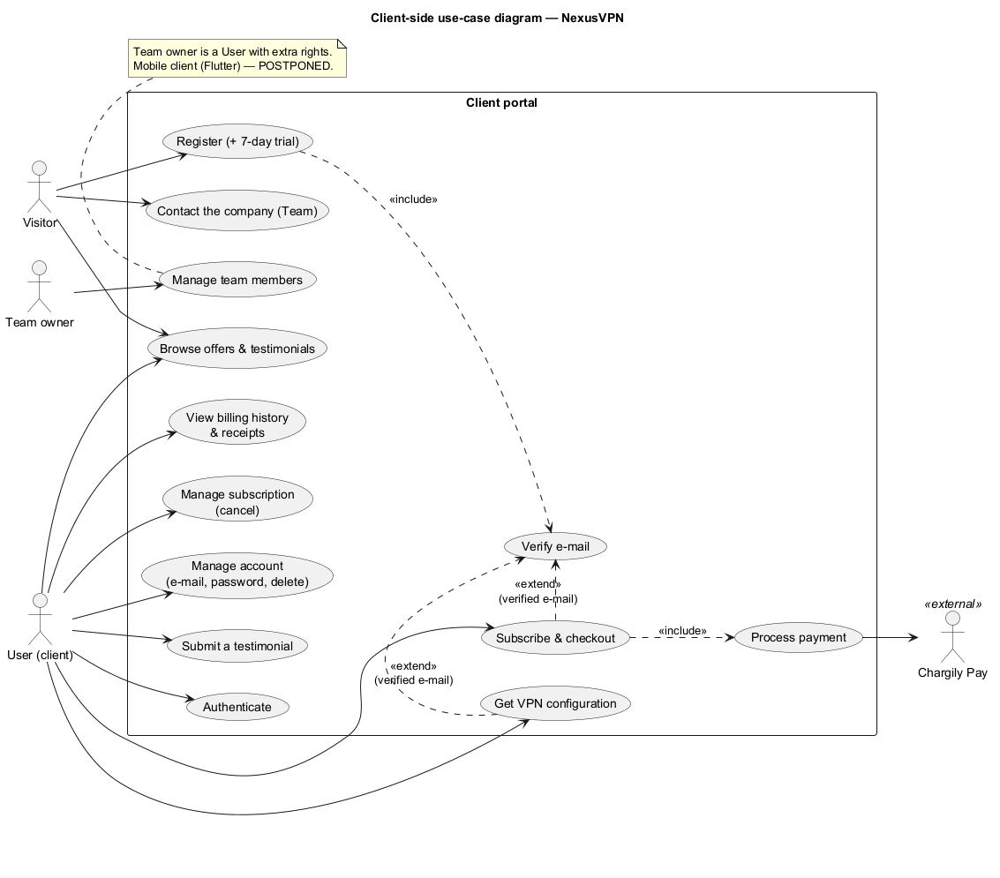

**Figure III.3 — Client use-case diagram.** *Source: prepared by the authors (UML, PlantUML).*

### III.5.3 Administration (and Support) Diagram
Figure III.4 shows the administrator's use cases in the back office, including the support activities merged in (handling contact requests, moderating testimonials); every administrative action is recorded in the audit log.

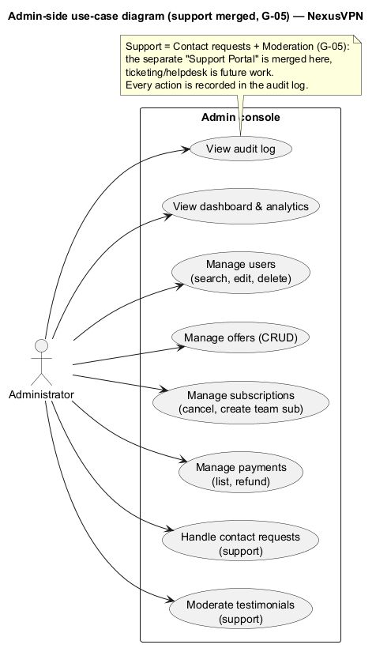

**Figure III.4 — Administration use-case diagram (support merged).** *Source: prepared by the authors (UML, PlantUML).*

### III.5.4 Mobile Diagram — placeholder
> **Mobile use-case diagram — placeholder.** The native client is future work; its use-case diagram (the client subset reached over `/api/mobile/*`) will be added when the Flutter app is resumed.

## III.6 Sequence Diagrams

The following sequence diagrams detail the dynamic behaviour of the main use cases. Each one shows the messages exchanged between the user, the front end, the Laravel API, the database and, where relevant, the external Chargily gateway and the administrator.

**Registration and e-mail verification (UC-01).** Figure III.5 shows a visitor registering: the API creates the account, opens the session and sends a signed verification link, which the user then opens to verify their e-mail.

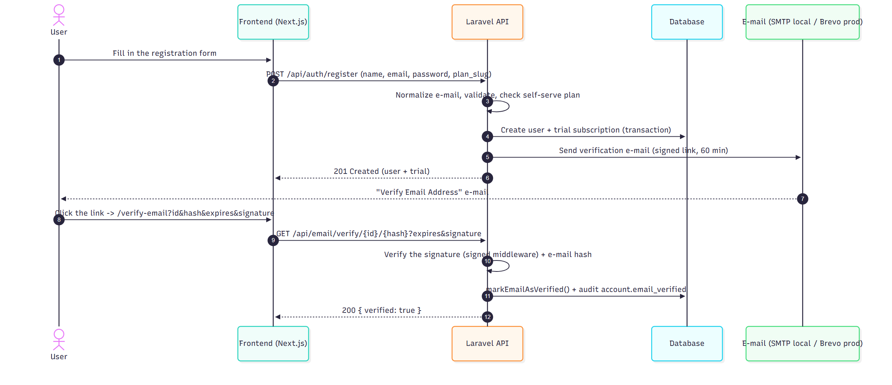

**Figure III.5 — Sequence diagram: registration and e-mail verification (UC-01).** *Source: prepared by the authors (UML).*

**Login (UC-01).** Figure III.6 shows the login flow, including the CSRF-cookie handshake, the login throttle (five failed attempts for the same e-mail and IP within a 60-second window, on top of the per-IP route throttle), and the audit of successful admin logins and failed attempts.

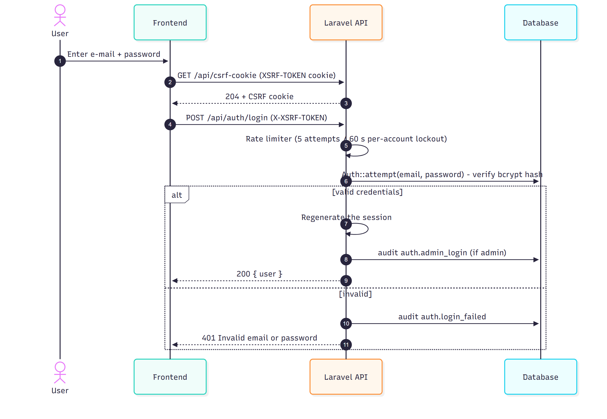

**Figure III.6 — Sequence diagram: login (UC-01).** *Source: prepared by the authors (UML).*

**Browse offers (UC-02).** Figure III.7 shows the public browsing flow: the front end reads the active plans (cached) and the approved testimonials and renders them.

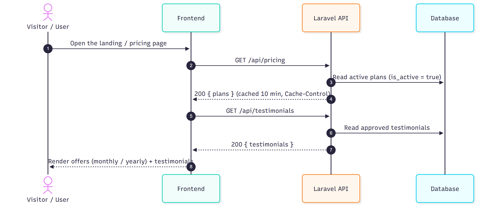

**Figure III.7 — Sequence diagram: browse VPN offers (UC-02).** *Source: prepared by the authors (UML).*

**Subscribe and payment (UC-04, UC-05).** Figure III.8 shows the checkout and payment flow: the amount is computed on the server, a pending payment and a Chargily checkout are created, and the payment is confirmed through two paths — the HMAC-signed webhook (server-to-server) and the browser return with an active verification fallback — applied idempotently.

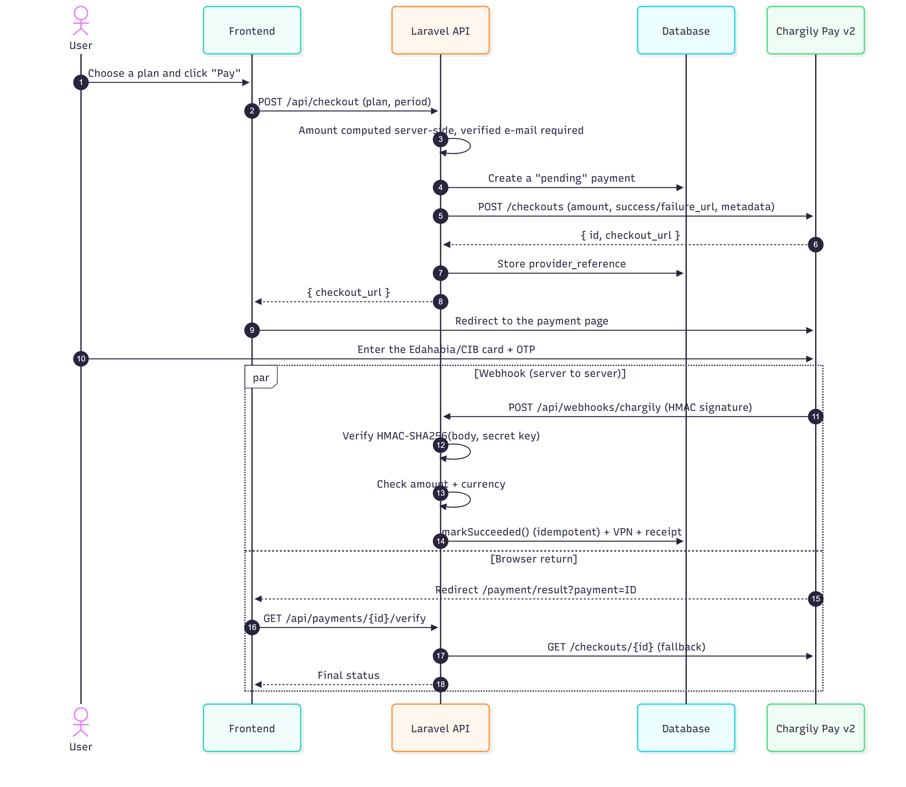

**Figure III.8 — Sequence diagram: subscribe and payment via Chargily (UC-04, UC-05).** *Source: prepared by the authors (UML).*

**Get the VPN configuration (UC-03, UC-06).** Figure III.9 shows the provisioning flow: the server checks access and a verified e-mail, issues a WireGuard peer (key pair + address) and returns the `.conf` file.

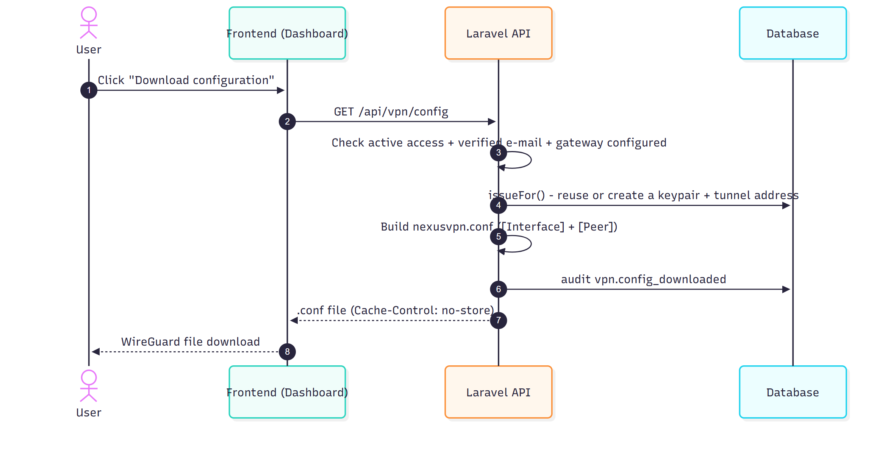

**Figure III.9 — Sequence diagram: get the VPN configuration (UC-03, UC-06).** *Source: prepared by the authors (UML).*

**Cancel a subscription (UC-09).** Figure III.10 shows cancellation and its two outcomes: a trial ends immediately and its VPN peer is revoked, while a paid period is kept until it ends.

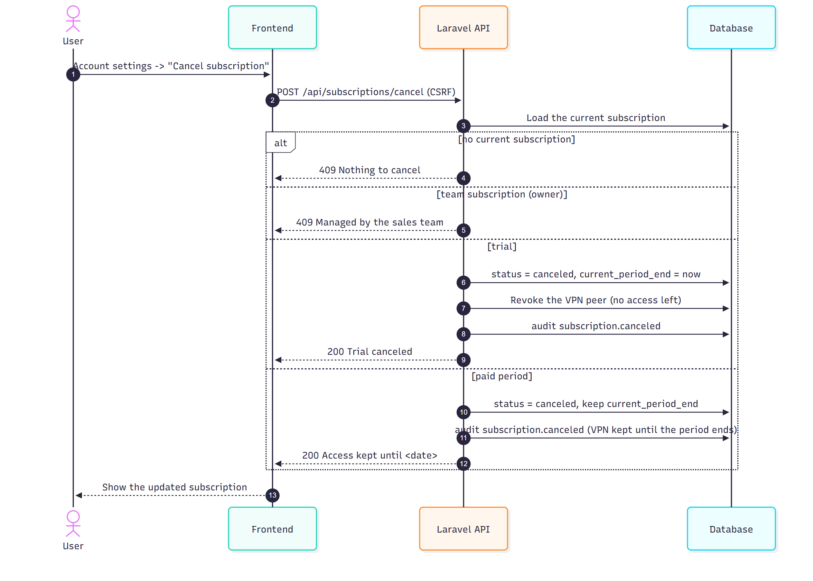

**Figure III.10 — Sequence diagram: cancel a subscription (UC-09).** *Source: prepared by the authors (UML).*

**Contact request (UC-10).** Figure III.11 shows a sales inquiry being submitted and stored, then listed and marked handled by an administrator.

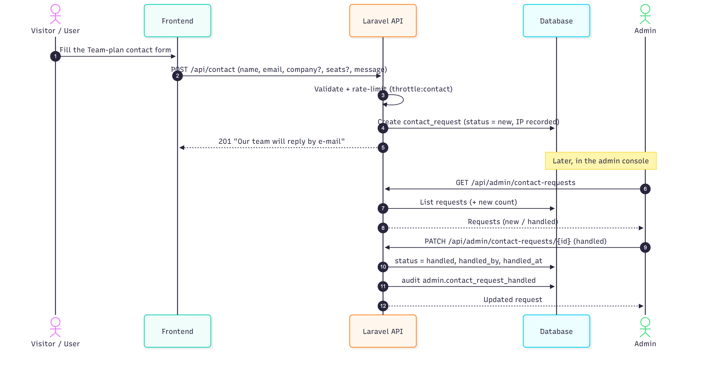

**Figure III.11 — Sequence diagram: contact the company (UC-10).** *Source: prepared by the authors (UML).*

**Administrator deletes a user.** Figure III.12 shows an administrator deleting an account: the shared "close account" logic anonymises and soft-deletes the user (keeping anonymised billing history), revokes VPN access and records the action, with the last-admin / self / team-owner guards.

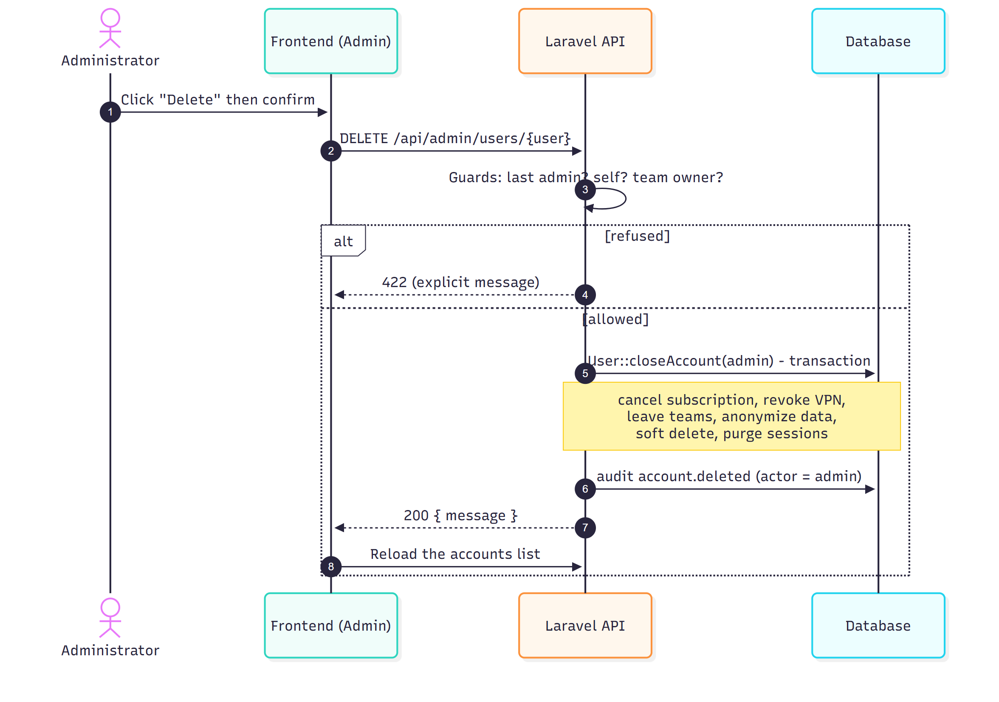

**Figure III.12 — Sequence diagram: an administrator deletes a user.** *Source: prepared by the authors (UML).*

> **Mobile sequence diagrams — placeholder.** Token-based login and checkout over `/api/mobile/*` will be added when the Flutter client is resumed.

## III.7 Class Diagram

Figure III.13 gives the class (domain) model of the system, obtained from the Eloquent models. The central class is **User**, linked to **Subscription**, **Payment**, **VpnCredential**, **Testimonial**, **ContactRequest** and **AuditLog**, and — for teams — to **Team** (as owner and, through the membership pivot, as member). **Plan** defines the offers that subscriptions reference. The main operations are shown (for example `Subscription.cancel()` and `grantsAccess()`, `VpnCredential.issueFor()` and `revokeFor()`, `User.closeAccount()`). `PersonalAccessToken` (Sanctum, for the mobile client) is shown as a postponed element.

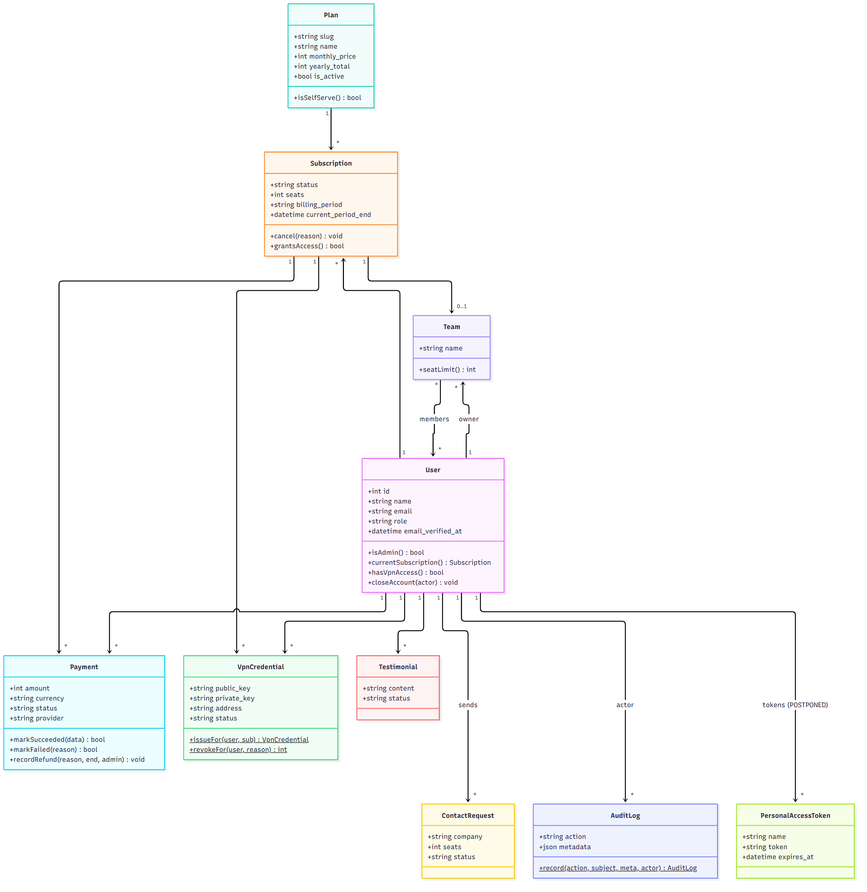

**Figure III.13 — Class diagram of the domain model.** *Source: prepared by the authors (UML).*

## III.8 Relational Database Model

Mapping the class model to a relational schema gives the following relations (primary keys are <u>underlined</u>, foreign keys are prefixed with `#`, and `?` marks a nullable attribute). The same schema is shown as an entity-relationship diagram, split for readability into the commercial core (Figure III.14a) and the teams, support and audit tables (Figure III.14b); every foreign key is also listed in the relations below.

- **USERS**(<u>id</u>, name, email *UK*, password, email_verified_at?, remember_token?, role, deleted_at?, created_at, updated_at)
- **PLANS**(<u>id</u>, slug *UK*, name, description?, monthly_price?, yearly_price?, yearly_total?, currency, features?, popular, cta?, is_active, deleted_at?, created_at, updated_at)
- **SUBSCRIPTIONS**(<u>id</u>, #user_id→USERS, #plan_id→PLANS, seats, billing_period, status, started_at?, trial_ends_at?, current_period_end?, canceled_at?, trial_reminder_sent_at?, renewal_reminder_sent_at?, deleted_at?, created_at, updated_at) — *partial* UNIQUE(user_id) *while* status ∈ {active, trialing}
- **PAYMENTS**(<u>id</u>, #user_id→USERS, #subscription_id?→SUBSCRIPTIONS, amount, currency, status, provider?, provider_reference? *UK*, provider_response?, metadata?, paid_at?, failure_reason?, error_code?, refunded_at?, refund_reason?, deleted_at?, created_at, updated_at)
- **TEAMS**(<u>id</u>, name, #owner_id→USERS, #subscription_id?→SUBSCRIPTIONS, created_at, updated_at)
- **TEAM_USER**(<u>#team_id→TEAMS</u>, <u>#user_id→USERS</u>, role, created_at)
- **VPN_CREDENTIALS**(<u>id</u>, #user_id→USERS, #subscription_id?→SUBSCRIPTIONS, public_key *UK*, private_key *(encrypted)*, address *UK*, status, revoked_at?, created_at, updated_at)
- **TESTIMONIALS**(<u>id</u>, #user_id→USERS, content, status, #moderated_by?→USERS, moderated_at?, created_at, updated_at)
- **CONTACT_REQUESTS**(<u>id</u>, #user_id?→USERS, name, email, company?, seats?, message, status, #handled_by?→USERS, handled_at?, ip_address?, created_at, updated_at)
- **AUDIT_LOGS**(<u>id</u>, #actor_id?→USERS, action, subject_type?, subject_id?, metadata?, ip_address?, created_at)
- **PERSONAL_ACCESS_TOKENS**(<u>id</u>, tokenable_type, tokenable_id, name, token *UK*, abilities?, last_used_at?, expires_at?, created_at, updated_at) — *Sanctum, mobile client — postponed*

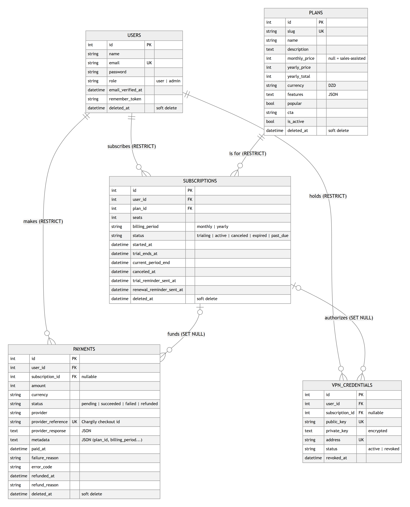

**Figure III.14a — Entity-relationship diagram (commercial core: accounts, offers, subscriptions, payments and VPN credentials).** *Source: prepared by the authors.*

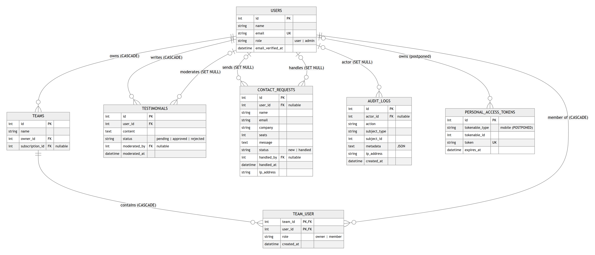

**Figure III.14b — Entity-relationship diagram (teams, support, audit and mobile tokens). The team-coverage link (a subscription covers a team) is shown in Figure III.14a and in the relations above.** *Source: prepared by the authors.*

## III.9 Data Dictionary

Table III.25 is the data dictionary of the database. Types use the convention: **A** = alphabetic, **N** = numeric, **AN** = alphanumeric, **D** = date/datetime, **B** = boolean, **J** = JSON, **T** = text. The **Size** column gives the maximum character length of text-type fields (— where it does not apply). The `created_at` / `updated_at` timestamps present on most tables are omitted for brevity.

| Entity | Field | Meaning | Type | Size | Constraint |
|---|---|---|---|---|---|
| USERS | id | Identifier | N | — | PK, auto |
| USERS | name | Display name | AN | 150 | required |
| USERS | email | Login e-mail | AN | 191 | unique, lowercased |
| USERS | password | Password (bcrypt hash) | AN | 191 | required, hidden |
| USERS | email_verified_at | E-mail verification date | D | — | nullable |
| USERS | remember_token | “Remember me” token | AN | 100 | nullable, hidden |
| USERS | role | `user` / `admin` | A | 20 | default `user` |
| USERS | deleted_at | Soft-delete date | D | — | nullable |
| PLANS | id | Identifier | N | — | PK, auto |
| PLANS | slug | Technical key | AN | 100 | unique |
| PLANS | name | Plan name | AN | 150 | required |
| PLANS | description | Short description | T | — | nullable |
| PLANS | monthly_price | Monthly price (DZD) | N | — | nullable (null = sales-assisted) |
| PLANS | yearly_price | Displayed per-month yearly price | N | — | nullable |
| PLANS | yearly_total | Yearly total charged (DZD) | N | — | nullable |
| PLANS | currency | Currency | A | 10 | `DZD` |
| PLANS | features | Feature list | J | — | nullable |
| PLANS | popular | “Most popular” flag | B | — | default false |
| PLANS | cta | Call-to-action label | AN | 100 | nullable |
| PLANS | is_active | Shown on the pricing page | B | — | default true |
| PLANS | deleted_at | Soft-delete date | D | — | nullable |
| SUBSCRIPTIONS | id | Identifier | N | — | PK, auto |
| SUBSCRIPTIONS | user_id | Owner | N | — | FK → USERS, RESTRICT |
| SUBSCRIPTIONS | plan_id | Plan | N | — | FK → PLANS, RESTRICT |
| SUBSCRIPTIONS | seats | Number of seats | N | — | default 1 |
| SUBSCRIPTIONS | billing_period | `monthly` / `yearly` | A | — | enum, required |
| SUBSCRIPTIONS | status | trialing / active / canceled / expired / past_due | A | 20 | required |
| SUBSCRIPTIONS | started_at | Start date | D | — | nullable |
| SUBSCRIPTIONS | trial_ends_at | Trial end | D | — | nullable |
| SUBSCRIPTIONS | current_period_end | Access end of the current period | D | — | nullable |
| SUBSCRIPTIONS | canceled_at | Cancellation date | D | — | nullable |
| SUBSCRIPTIONS | trial_reminder_sent_at | Trial-ending reminder sent | D | — | nullable |
| SUBSCRIPTIONS | renewal_reminder_sent_at | Renewal reminder sent | D | — | nullable |
| SUBSCRIPTIONS | deleted_at | Soft-delete date | D | — | nullable |
| PAYMENTS | id | Identifier | N | — | PK, auto |
| PAYMENTS | user_id | Payer | N | — | FK → USERS, RESTRICT |
| PAYMENTS | subscription_id | Related subscription | N | — | FK → SUBSCRIPTIONS, SET NULL, nullable |
| PAYMENTS | amount | Amount (DZD) | N | — | required |
| PAYMENTS | currency | Currency | A | 10 | required |
| PAYMENTS | status | pending / succeeded / failed / refunded | A | 20 | required |
| PAYMENTS | provider | Payment provider | A | 191 | nullable (`chargily`) |
| PAYMENTS | provider_reference | Provider checkout reference | AN | 191 | unique, nullable |
| PAYMENTS | provider_response | Raw provider response | J | — | nullable, hidden |
| PAYMENTS | metadata | Checkout metadata | J | — | nullable |
| PAYMENTS | paid_at | Payment date | D | — | nullable |
| PAYMENTS | refunded_at | Refund date | D | — | nullable |
| PAYMENTS | failure_reason | Failure message | AN | 191 | nullable |
| PAYMENTS | error_code | Error code | AN | 100 | nullable |
| PAYMENTS | refund_reason | Refund reason | AN | 191 | nullable |
| PAYMENTS | deleted_at | Soft-delete date | D | — | nullable |
| VPN_CREDENTIALS | id | Identifier | N | — | PK, auto |
| VPN_CREDENTIALS | user_id | Owner | N | — | FK → USERS, RESTRICT |
| VPN_CREDENTIALS | subscription_id | Related subscription | N | — | FK → SUBSCRIPTIONS, SET NULL, nullable |
| VPN_CREDENTIALS | public_key | WireGuard public key | AN | 64 | unique |
| VPN_CREDENTIALS | private_key | WireGuard private key | T | — | encrypted |
| VPN_CREDENTIALS | address | Tunnel IP address | AN | 45 | unique |
| VPN_CREDENTIALS | status | active / revoked | A | 20 | required |
| VPN_CREDENTIALS | revoked_at | Revocation date | D | — | nullable |
| TEAMS | id | Identifier | N | — | PK, auto |
| TEAMS | name | Team name | AN | 150 | required |
| TEAMS | owner_id | Owner | N | — | FK → USERS, CASCADE |
| TEAMS | subscription_id | Team subscription | N | — | FK → SUBSCRIPTIONS, SET NULL, nullable |
| TEAM_USER | team_id | Team (composite key) | N | — | PK, FK → TEAMS, CASCADE |
| TEAM_USER | user_id | Member (composite key) | N | — | PK, FK → USERS, CASCADE |
| TEAM_USER | role | `owner` / `member` | A | 50 | default `member` |
| TESTIMONIALS | id | Identifier | N | — | PK, auto |
| TESTIMONIALS | user_id | Author | N | — | FK → USERS, CASCADE |
| TESTIMONIALS | content | Testimonial text | T | — | required |
| TESTIMONIALS | status | pending / approved / rejected | A | 20 | default `pending` |
| TESTIMONIALS | moderated_by | Moderator | N | — | FK → USERS, SET NULL, nullable |
| TESTIMONIALS | moderated_at | Moderation date | D | — | nullable |
| CONTACT_REQUESTS | id | Identifier | N | — | PK, auto |
| CONTACT_REQUESTS | user_id | Sender (if signed in) | N | — | FK → USERS, SET NULL, nullable |
| CONTACT_REQUESTS | name | Contact name | AN | 150 | required |
| CONTACT_REQUESTS | email | Contact e-mail | AN | 191 | required |
| CONTACT_REQUESTS | company | Company | AN | 150 | nullable |
| CONTACT_REQUESTS | seats | Seats requested | N | — | nullable |
| CONTACT_REQUESTS | message | Message | T | — | required |
| CONTACT_REQUESTS | status | `new` / `handled` | A | 20 | default `new` |
| CONTACT_REQUESTS | handled_by | Handling admin | N | — | FK → USERS, SET NULL, nullable |
| CONTACT_REQUESTS | handled_at | Handling date | D | — | nullable |
| CONTACT_REQUESTS | ip_address | Sender IP | AN | 45 | nullable |
| AUDIT_LOGS | id | Identifier | N | — | PK, auto |
| AUDIT_LOGS | actor_id | Acting user | N | — | FK → USERS, SET NULL, nullable |
| AUDIT_LOGS | action | Event name | AN | 100 | required |
| AUDIT_LOGS | subject_type | Affected entity type | AN | 100 | nullable |
| AUDIT_LOGS | subject_id | Affected entity id | N | — | nullable |
| AUDIT_LOGS | metadata | Event details | J | — | nullable |
| AUDIT_LOGS | ip_address | Source IP | AN | 45 | nullable |

**Table III.25 — Data dictionary of the database.** *Source: prepared by the authors, from the database migrations.* (The postponed `PERSONAL_ACCESS_TOKENS` table is omitted; see III.8.)

## III.10 Business Logic and Rules

The main business rules enforced by the system are:

1. **One active subscription per user** — enforced by a partial-unique index; a new current subscription cannot coexist with another (a violation returns 409).
2. **Trial once per account** — a user who has (or has had) any subscription cannot start a new trial.
3. **Access follows the period, not the status** — access is granted while `current_period_end` is in the future, even after a user cancels a *paid* period; a canceled *trial* ends immediately.
4. **Idempotent payment** — the pending→succeeded transition is a locked conditional update, so the webhook and the active verification can both fire and the payment is applied exactly **once**.
5. **Activate only on verified data** — a `paid` checkout activates a subscription only if the **amount and currency match** the stored record, otherwise `amount_mismatch` / `currency_mismatch` and no activation.
6. **Subscription application** — the same plan active → renewal (extend); the same plan trialing → conversion to paid; a different current plan → plan change (the previous one ends now); none → a new subscription (resuming a canceled plan starts after the days already paid).
7. **VPN provisioning** — one active peer per user; the tunnel address is drawn from the pool `10.66.0.0/16` and is **never reused**; the private key is stored encrypted; the peer is revoked when no subscription grants access.
8. **Account deletion** — anonymise + soft-delete (keeping anonymised billing history); administrators and team owners cannot delete their own account.
9. **Server-side amounts** — the client never sends a price; the server computes the amount from the plan.
10. **Audit** — every security- and billing-relevant event is recorded in an append-only audit log, without secrets.

These rules govern the **subscription lifecycle**, whose states and transitions are summarised in Figure III.15. A subscription is created either as a seven-day **trial** or directly as **active** on payment; a trial converts to active on payment, ends immediately (**canceled**) on cancellation, or becomes **expired** when the trial period ends. An active subscription is renewed or changed in place, becomes **canceled** on cancellation (keeping access until the paid period ends), or becomes **expired** when its current period ends. A `past_due` status exists in the schema but is not produced by the current version.

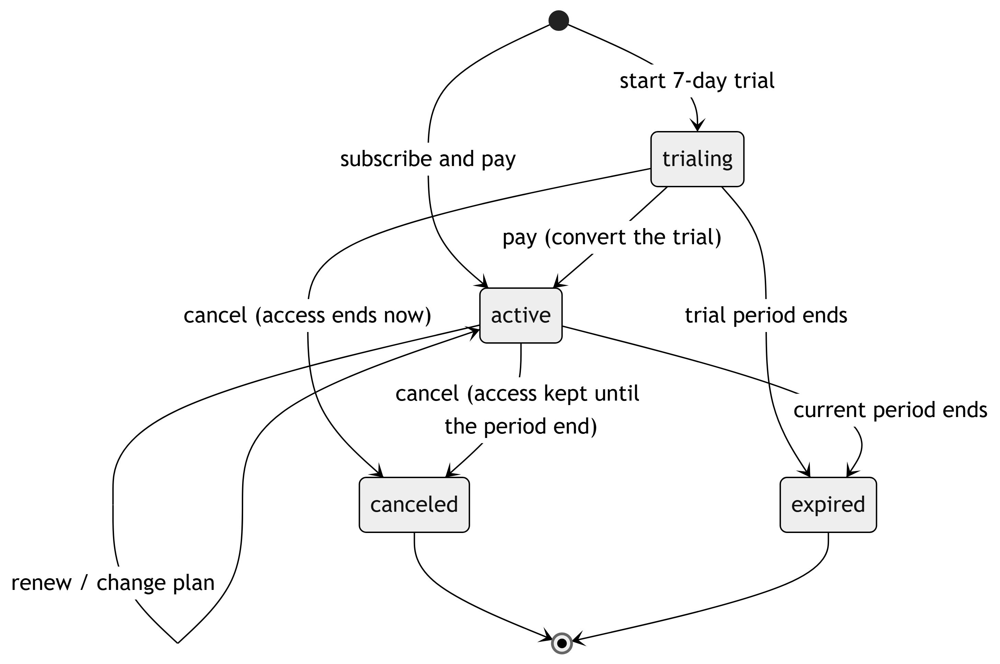

**Figure III.15 — State diagram of the subscription lifecycle.** *Source: prepared by the authors (UML).*

## III.11 Relationships and Cardinalities

Table III.26 lists the relationships between entities, their cardinalities and their on-delete behaviour (also visible in the entity-relationship diagrams, Figures III.14a–III.14b). The on-delete rules deliberately protect billing history: subscriptions, payments and VPN credentials use RESTRICT on the user, so a user who has them cannot be hard-deleted (account closure anonymises and soft-deletes instead, rule 8).

| Relationship | Cardinality | On delete |
|---|---|---|
| User — Subscription | 1 : 0..* (at most 1 *current*) | RESTRICT |
| Plan — Subscription | 1 : 0..* | RESTRICT |
| User — Payment | 1 : 0..* | RESTRICT |
| Subscription — Payment | 0..1 : 0..* | SET NULL |
| User — VpnCredential | 1 : 0..* (1 active) | RESTRICT |
| Subscription — VpnCredential | 0..1 : 0..* | SET NULL |
| User — Team (owns) | 1 : 0..* | CASCADE |
| Subscription — Team | 0..1 : 0..1 | SET NULL |
| Team — User (members, via TEAM_USER) | * : * | CASCADE |
| User — Testimonial (author / moderator) | 1 : 0..* / 0..1 : 0..* | CASCADE / SET NULL |
| User — ContactRequest (sender / handler) | 0..1 : 0..* | SET NULL |
| User — AuditLog (actor) | 0..1 : 0..* | SET NULL |

**Table III.26 — Relationships and cardinalities.** *Source: prepared by the authors, from the schema's foreign keys.*

## III.12 Project Planning (Gantt Chart)

> **Gantt chart — placeholder (real dates pending).** The project was carried out in the phases listed below; the **start dates and durations are to be provided by the student** and the Gantt chart inserted here (Figure III.16). The chart is intentionally left out rather than drawn with invented dates.
>
> Planned phases: (1) analysis and requirements; (2) design (UML models, database); (3) backend development (Laravel API, payment and VPN provisioning); (4) frontend development (Next.js); (5) security hardening; (6) testing; (7) documentation (mémoire); (8) deployment.

**Figure III.16 — Gantt chart of the project (to be inserted when the real dates are available).** *Source: prepared by the authors.*

## Conclusion

This chapter analysed and designed the VPN sales portal with UML. It gave an overview of the system and its two-tier architecture, identified the stakeholders and mapped the five business roles onto the implemented `user` / `admin` roles with a permission matrix. It specified the use cases — the ten core client use cases together with the further client, administration and team-management use cases — in textual form and in use-case diagrams, detailed the main scenarios with eight sequence diagrams, and modelled the structure with a class diagram. It then described the data design — the relational model, a full data dictionary, the business rules and the relationships and cardinalities — and set out the project phases, leaving the Gantt chart as a marked placeholder pending the real dates. The next chapter presents the implementation and deployment of this design.

---

## Notes

[^uml]: Object Management Group (OMG): *OMG Unified Modeling Language (OMG UML), Version 2.5.1*, document formal/2017-12-05, OMG, December 2017. https://www.omg.org/spec/UML/2.5.1/ (consulted on 11/10/2026).
