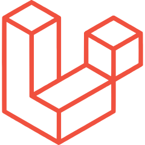
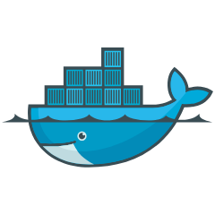
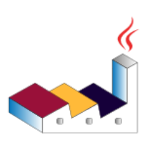
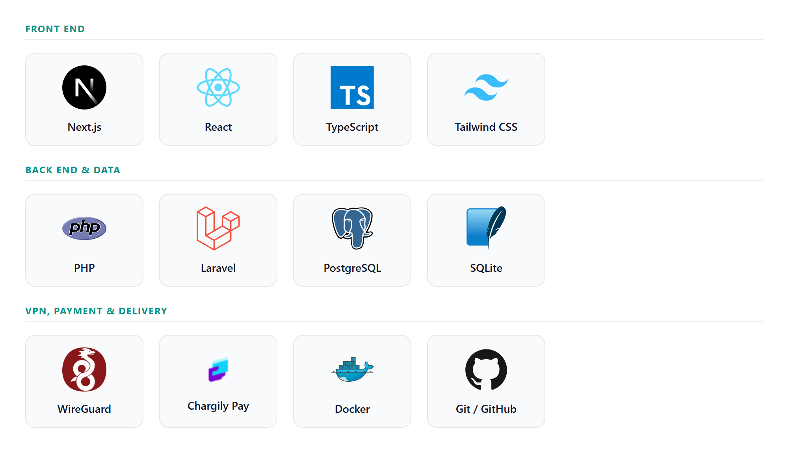
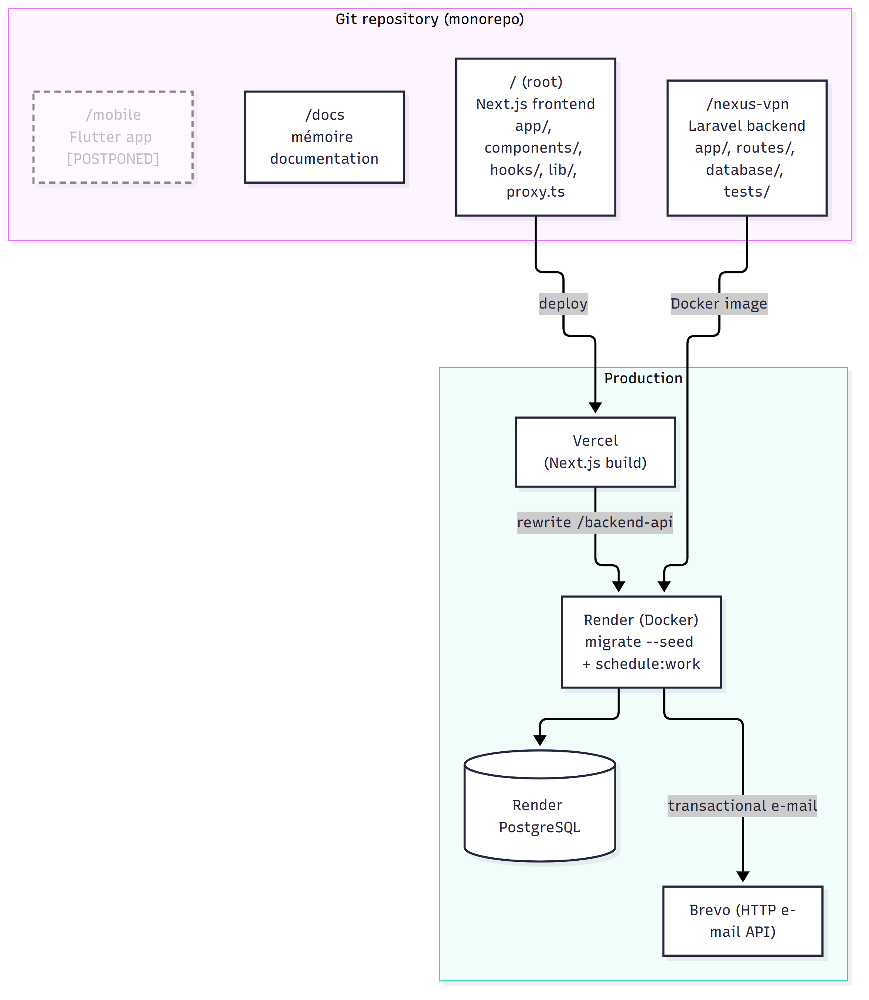

# CHAPTER IV — Implementation and Deployment

## Introduction

The previous chapter translated the requirements into a design — actors, use cases, data model and business rules. This chapter turns that design into a working system and prepares its deployment. It presents, in order, the technologies and tools chosen for the project (IV.1), the overall software architecture (IV.2), the functional modules that make up the portal (IV.3), a walk-through of the user interface (IV.4), the implementation of the most critical components with excerpts from the source code (IV.5), the quality-assurance and testing work (IV.6), and finally the production environment, continuous integration and monitoring (IV.7).

The chapter is precise about the state of the system. The portal is fully implemented and covered by an automated backend test suite; it is prepared for deployment on free hosting tiers but has not yet been operated in production. Wherever a claim would require the live site (security scans, load tests, production screenshots), the chapter states what can be shown from the code and configuration today and marks the remaining evidence as a clearly identified item of future work.

## IV.1 Technologies and Tools

The portal is built as two applications — a **Next.js** front end and a **Laravel** REST API — supported by a small, deliberately conventional set of tools. This section presents each technology with its logo, its role and the exact version in use, grouped by purpose; Figure IV.1 gathers the main ones in a single view. The versions were read from `nexus-vpn/composer.lock` and the frontend `package.json` / `pnpm-lock.yaml`.

### IV.1.1 Languages and frameworks

{height=0.6cm} **PHP**[^php] 8.2 (8.3 in the production image) — the back-end language.

{height=0.6cm} **Laravel**[^laravel] 12.60.2 — the back-end framework: routing, the Eloquent ORM, request validation, sessions and CSRF protection, rate limiting, a task scheduler, an HTTP client (used to call Chargily) and an encryption layer (used to encrypt the stored VPN private keys). The API exposes JSON only; it renders no HTML for the real application.

{height=0.6cm} **Next.js**[^nextjs] 16.2.6 — the front-end framework. It uses the App Router, server-side rendering and middleware (`proxy.ts`) to gate the private areas and to rewrite API calls to the Laravel service on the same origin.

{height=0.6cm} **React**[^react] 19.2.4 — the user-interface library the front end is built on.

{height=0.6cm} **TypeScript**[^typescript] 5.7.3 — static typing (`strict` mode) across the whole front end.

{height=0.6cm} **Tailwind CSS**[^tailwind] 4.2.0 — the utility-first CSS framework; the interface is composed from accessible **shadcn/ui** components built on the Radix UI primitives.

### IV.1.2 Database management systems

Data is stored in a relational database accessed exclusively through Laravel's **Eloquent ORM**, so the same code runs on two engines.

{height=0.6cm} **SQLite**[^sqlite] — the development database; the automated tests run on an in-memory SQLite database, which keeps them fast and isolated.

{height=0.6cm} **PostgreSQL**[^postgresql] — the production database, hosted on Render. The schema is created and evolved by Laravel migrations, and no raw SQL is written by hand.

### IV.1.3 Security and payment technologies

{height=0.6cm} **Laravel Sanctum**[^sanctum] 4.3.3 — issues personal access tokens for the (postponed) mobile client, on routes kept outside the session/CSRF web group (IV.5.2).

{height=0.6cm} **Chargily Pay**[^chargily4] v2 — the payment gateway for the Algerian market: it accepts EDAHABIA and CIB cards in Algerian dinars through a hosted checkout and a signed webhook. No SDK is used — the integration goes through Laravel's HTTP client against the Chargily REST API.

{height=0.6cm} **WireGuard**[^wgproto4] — the VPN protocol. The PHP `sodium` extension generates its Curve25519 key pairs and Laravel's encrypter protects the private keys at rest (IV.1.6, IV.5.4).

Multi-factor authentication is **not** implemented and is listed as future work; the account-security measures actually in place — e-mail verification, a login throttle (per e-mail and IP) after repeated failures, named rate limiters and bcrypt password hashing — are described in IV.5.

### IV.1.4 Development and operations tools

{height=0.6cm} **Git** · {height=0.6cm} **GitHub** — version control and repository hosting, where the continuous-integration workflows run (IV.7.2).

{height=0.6cm} **Composer 2** — the PHP dependency manager.

{height=0.6cm} **Node.js 22** with **pnpm 10** — the JavaScript runtime and package manager used to build the front end.

{height=0.6cm} **Docker** — containerises the back end (base image `php:8.3-apache-bookworm`) for deployment on Render.

{height=0.6cm} **Vercel** — the hosting platform for the Next.js front end. **Render** — the hosting platform for the backend container and the managed PostgreSQL database. **Brevo** is the planned production e-mail service, to be used over its HTTP API (Gmail SMTP in development).

{height=0.6cm} **PHPUnit**[^phpunit] 11.5.55 — the back-end test framework (131 tests, IV.6).

{height=0.6cm} **ESLint 9.39** with **Laravel Pint 1.29** — static analysis and code style for the front end and the back end.

{height=0.6cm} **Playwright**[^playwright] 1.63 — drives a headless browser to capture the interface screenshots of this chapter.

### IV.1.5 Modelling tools

The UML and architecture diagrams of Chapter III were produced as **diagram-as-code**, so they live in the repository next to the chapters and are regenerated from text.

{height=0.6cm} **PlantUML**[^plantuml] — the use-case diagrams, laid out with the **Graphviz** engine.

{height=0.6cm} **Mermaid**[^mermaid] — the sequence, class, architecture and entity-relationship diagrams.

This diagram-as-code approach keeps every diagram versioned, reviewable and reproducible, and is used in place of a dedicated graphical UML editor.

### IV.1.6 Focus on a key technology: WireGuard provisioning

This section places the spotlight on **WireGuard provisioning** rather than the payment gateway. The choice is deliberate: WireGuard is the product itself (it gives the portal and the company their name), and, unlike the payment flow — which delegates to an external gateway — the provisioning logic is implemented from first principles inside the API, which makes it the most technically interesting component to examine.

WireGuard is a modern VPN protocol designed to be simpler and faster than IPsec or OpenVPN, using a fixed, modern set of cryptographic primitives.[^wgproto4] A WireGuard peer is identified by a **Curve25519** key pair: the client keeps a private key and shares its public key with the server. In this project the server generates the client's key pair, stores the private key **encrypted**, allocates a unique tunnel address from a private pool, and assembles a ready-to-import `nexusvpn.conf` file. The implementation is examined in IV.5.4; the limit of the current version — no live gateway is operated by the project — is stated there and in the conclusion.

{width=15cm}

**Figure IV.1 — Main technologies of the portal.** *Source: prepared by the authors; logos are the property of their respective projects.*

## IV.2 System Architecture

### IV.2.1 Architectural pattern

The system follows a **decoupled client–server** pattern: a Next.js front end and a single Laravel REST API, each deployed and scaled independently. The browser never calls the API across origins; instead it calls a same-origin path (`/backend-api/*`) that the Next.js layer rewrites to the Laravel service. This keeps the session cookie first-party and removes cross-origin complexity, while still allowing the two applications to be hosted on different platforms (Vercel and Render). The overall component view was given in Figure III.1.

The back end is a **modular monolith**, not a set of microservices. For a project built by a small team around a single bounded domain (selling and provisioning one VPN service), a monolith is the appropriate choice: it is simpler to develop, test and deploy, it keeps all business rules and the database under one transaction boundary, and it avoids the operational overhead (service discovery, inter-service contracts, distributed transactions) that microservices would add without a matching benefit at this scale. The code is nonetheless organised into clear modules (IV.3) so that responsibilities stay separated inside the single deployable unit.

### IV.2.2 Logical layers

Inside each application the code is organised in three layers:

| Layer | Front end (Next.js) | Back end (Laravel) |
|---|---|---|
| Presentation | React components, pages (App Router), `proxy.ts` route guard | JSON responses; no server-rendered HTML for the real app |
| Business logic | client-side form handling and view state | controllers, services (e.g. `ChargilyGateway`), domain methods on the models |
| Data | API client (`lib/api.ts`) over the same-origin rewrite | Eloquent models, migrations, SQLite / PostgreSQL |

**Table IV.1 — Logical layers of the system.** *Source: prepared by the authors.*

### IV.2.3 Third-party services

The API depends on three external services, each isolated behind a small, replaceable integration point:

- **Chargily Pay v2** — hosted checkout and signed webhook for EDAHABIA/CIB payments (IV.5.3).
- **E-mail** — Gmail SMTP in development; in production, Brevo's HTTP API is planned, because Render's free tier blocks outbound SMTP. Account e-mails are transactional (verification, password reset, welcome, receipt, reminders).
- **WireGuard gateway** — the server that terminates the tunnels. The portal issues peers and configuration files; running the gateway is the network team's responsibility and is not part of this repository.

## IV.3 Functional Modules

The portal is organised into nine functional modules. Each one groups a set of API endpoints and the business rules that govern them, and corresponds to the routes declared in `routes/api.php` and their controllers; the full list of endpoints is given in Appendix A.

### IV.3.1 Offers and pricing

Publishes the plans shown on the public pricing page. `GET /api/pricing` returns the active plans (cached for ten minutes); administrators manage them through the offers module (IV.3.8 / admin). Prices are stored in Algerian dinars and are never supplied by the client — the server always computes the amount from the plan.

### IV.3.2 Order management

Turns a chosen plan into a pending order. `POST /api/checkout` validates the selection, records a **pending payment first**, then creates a Chargily checkout and returns its hosted-payment URL. Recording the payment before contacting Chargily is what later lets the webhook find and complete the order idempotently (IV.5.3).

### IV.3.3 Billing and payment

Confirms payments and keeps the billing history. It handles the Chargily webhook (`POST /api/webhooks/chargily`) and the active verification fallback (`GET /api/payments/{id}/verify`), exposes the user's payment history and receipts, and lets an administrator record a refund (`POST /api/admin/payments/{payment}/refund`). Because Chargily Pay v2 has no refund API, a refund is **recorded** in the portal and reconciled manually in the Chargily dashboard.

### IV.3.4 Subscription management

Owns the subscription lifecycle: a seven-day trial once per account (`POST /api/subscriptions/trial`), activation and renewal on payment, cancellation (`POST /api/subscriptions/cancel`), and the scheduled expiry of ended periods. Access follows the paid period, not the status: a cancelled **paid** period keeps access until its end, while a cancelled **trial** ends immediately (IV.5).

### IV.3.5 VPN account provisioning (WireGuard keys and configuration files)

Issues and revokes the WireGuard peer that backs a user's access. On the first configuration download (`GET /api/vpn/config`), the server creates a key pair and tunnel address and returns a `nexusvpn.conf` file; the peer is revoked automatically when no subscription grants access any more (cancellation, expiry, refund or removal from a team). The cryptographic details are in IV.5.4.

### IV.3.6 User profile and account

Lets a signed-in user manage their account: change e-mail (which requires re-verification) or password (`PUT /api/account/email`, `PUT /api/account/password`), view their subscriptions and receipts, and permanently delete the account (`DELETE /api/account`). Deletion **anonymises and soft-deletes** the user while keeping the (anonymised) billing history, and frees the e-mail for reuse.

### IV.3.7 Authentication and access control

Provides registration, login, logout, e-mail verification and password reset for the web session, the equivalent token endpoints for the mobile client (`/api/mobile/*`), and role-based access control for the administration area. Its security-critical parts are detailed in IV.5.1–IV.5.2.

### IV.3.8 Support and administration

Covers the back-office console and the merged support activity (a dedicated ticketing system is future work). Administrators manage users, offers, subscriptions and payments, consult the audit log, and handle the two support channels — **contact requests** (`/api/admin/contact-requests`) and **testimonial moderation** (`/api/admin/testimonials`). Every administrative action is written to the audit log.

### IV.3.9 Team management

Lets the owner of a team plan manage their organisation: view or rename the team and adjust the number of seats (`GET /api/team`, `PATCH /api/team`), and invite or remove members (`POST /api/team/members`, `DELETE /api/team/members/{member}`). The seat count is enforced from the team's subscription, and a member removed from a team loses VPN access like any other loss of entitlement.

| Module | Key endpoints |
|---|---|
| Offers and pricing | `GET /api/pricing` |
| Order management | `POST /api/checkout` |
| Billing and payment | `POST /api/webhooks/chargily`, `GET /api/payments/{id}/verify`, `POST /api/admin/payments/{id}/refund` |
| Subscription management | `POST /api/subscriptions/trial`, `POST /api/subscriptions/cancel` |
| VPN provisioning | `GET /api/vpn/config` |
| User profile and account | `PUT /api/account/email`, `PUT /api/account/password`, `DELETE /api/account` |
| Authentication and access control | `POST /api/auth/register`, `POST /api/auth/login`, `/api/mobile/*` |
| Support and administration | `GET /api/admin/*` (users, plans, subscriptions, payments, testimonials, contact-requests, audit-logs) |
| Team management | `GET /api/team`, `PATCH /api/team`, `POST /api/team/members`, `DELETE /api/team/members/{member}` |

**Table IV.2 — Functional modules and their main endpoints.** *Source: prepared by the authors, from `routes/api.php`.*

## IV.4 User Interface Walkthrough

This section walks through the main screens of the running application, captured with Playwright on seeded demonstration data. The client interface comes first, then the administration console and the support views, and finally the responsive (mobile-width) views and the postponed native client.

### IV.4.1 Client interface

The public site is a single scrolling landing page followed by the authenticated dashboard.

The page opens with the navigation bar and the hero section (Figure IV.2), which states the value proposition and carries the primary call to action.

{width=14cm}

**Figure IV.2 — Public home page: navigation bar and hero.** *Source: prepared by the authors.*

Below it, the features section (Figure IV.3) summarises what the service offers to a subscriber.

{width=14cm}

**Figure IV.3 — Home page: features section.** *Source: prepared by the authors.*

The network section (Figure IV.4) illustrates how a subscriber's traffic is routed privately over WireGuard.

{width=14cm}

**Figure IV.4 — Home page: the network section (private routing over WireGuard).** *Source: prepared by the authors.*

Approved customer testimonials follow (Figure IV.5); each one is moderated by an administrator before it appears.

{width=14cm}

**Figure IV.5 — Home page: approved customer testimonials.** *Source: prepared by the authors.*

The pricing section (Figure IV.6) lists the plans, with every amount shown in Algerian dinars and computed on the server.

{width=14cm}

**Figure IV.6 — Home page: pricing plans (in Algerian dinars).** *Source: prepared by the authors.*

Organisations that need several seats use the Team-plan contact form (Figure IV.7) to request a sales-assisted quote.

{width=14cm}

**Figure IV.7 — Home page: Team-plan contact form.** *Source: prepared by the authors.*

The footer (Figure IV.8) closes the page with the secondary navigation links.

{width=14cm}

**Figure IV.8 — Home page: footer.** *Source: prepared by the authors.*

Authentication takes place in modal dialogs layered over the landing page; the sign-in dialog is shown in Figure IV.9.

{width=10cm}

**Figure IV.9 — Authentication: sign-in dialog.** *Source: prepared by the authors.*

A visitor can create an account and choose a plan at the same time in the sign-up dialog (Figure IV.10).

{width=10cm}

**Figure IV.10 — Authentication: sign-up dialog (with plan selection).** *Source: prepared by the authors.*

Validation errors returned by the API are surfaced inline, as in Figure IV.11.

{width=10cm}

**Figure IV.11 — Authentication: server-side validation error.** *Source: prepared by the authors.*

A user who has forgotten their password requests a reset link through the form in Figure IV.12,

{width=10cm}

**Figure IV.12 — Authentication: forgotten-password request.** *Source: prepared by the authors.*

and receives the neutral confirmation message of Figure IV.13, which does not reveal whether the address is registered.

{width=10cm}

**Figure IV.13 — Authentication: confirmation message.** *Source: prepared by the authors.*

After signing in, the subscriber reaches the dashboard; Figure IV.14 shows the active subscription and the VPN-access panel.

{width=14cm}

**Figure IV.14 — Client dashboard: subscription status and VPN access.** *Source: prepared by the authors.*

When no subscription is active, the dashboard shows the empty state of Figure IV.15,

{width=14cm}

**Figure IV.15 — Client dashboard: empty state (no active subscription).** *Source: prepared by the authors.*

and after a failed payment it shows the recovery state of Figure IV.16, which invites the user to try again.

{width=14cm}

**Figure IV.16 — Client dashboard: failed-payment state.** *Source: prepared by the authors.*

Checkout begins with the payment dialog of Figure IV.17, shown just before the redirection to Chargily's hosted page.

{width=10cm}

**Figure IV.17 — Checkout: payment dialog before redirection to Chargily.** *Source: prepared by the authors.*

Once a payment succeeds, the subscriber can open the receipt dialog of Figure IV.18.

{width=10cm}

**Figure IV.18 — Billing: payment receipt dialog.** *Source: prepared by the authors.*

Account settings (Figure IV.19) let the user change their e-mail or password and delete the account.

{width=14cm}

**Figure IV.19 — Account settings: e-mail, password and account deletion.** *Source: prepared by the authors.*

Finally, the owner of a team plan manages its members from the view in Figure IV.20.

{width=14cm}

**Figure IV.20 — Client dashboard: team-member management (team owner).** *Source: prepared by the authors.*

### IV.4.2 Administration console

The administrator operates a back-office console with a section for each business area.

The console opens on the overview of Figure IV.21, which gathers the key figures computed from the billing data.

{width=14cm}

**Figure IV.21 — Administration: overview.** *Source: prepared by the authors.*

The accounts section (Figure IV.22) lists the user accounts and lets an administrator manage them.

{width=14cm}

**Figure IV.22 — Administration: user accounts.** *Source: prepared by the authors.*

Plans are created and edited in the offers section (Figure IV.23).

{width=14cm}

**Figure IV.23 — Administration: offers (plans) management.** *Source: prepared by the authors.*

The subscriptions section (Figure IV.24) shows every subscription and its current state.

{width=14cm}

**Figure IV.24 — Administration: subscriptions.** *Source: prepared by the authors.*

Payments, including the recording of refunds, are handled in the section of Figure IV.25.

{width=14cm}

**Figure IV.25 — Administration: payments and refunds.** *Source: prepared by the authors.*

The analytics section (Figure IV.26) presents the charts, which are drawn by hand in the front end.

{width=14cm}

**Figure IV.26 — Administration: analytics (custom-built charts).** *Source: prepared by the authors.*

Every security- and billing-relevant action is traceable in the audit log (Figure IV.27).

{width=14cm}

**Figure IV.27 — Administration: audit log.** *Source: prepared by the authors.*

### IV.4.3 Support views

Support is handled inside the administration console: testimonial moderation and the contact-request inbox.

Customer testimonials awaiting a decision appear in the moderation queue of Figure IV.28, where an administrator approves or rejects each one.

{width=14cm}

**Figure IV.28 — Support: testimonial moderation.** *Source: prepared by the authors.*

Sales-assisted enquiries submitted through the Team-plan form arrive in the contact-request inbox of Figure IV.29, where an administrator reads a request and marks it as handled.

{width=14cm}

**Figure IV.29 — Support: contact-request inbox.** *Source: prepared by the authors.*

### IV.4.4 Responsive and mobile

The web application is responsive and usable at phone width, as the following captures show. These are the **web** application in a narrow viewport, not a native application.

Figure IV.30 shows the landing page at phone width, with the navigation collapsed into a menu.

{width=6.5cm}

**Figure IV.30 — Responsive web: home page at phone width.** *Source: prepared by the authors.*

Figure IV.31 shows the dashboard in the same narrow viewport.

{width=6.5cm}

**Figure IV.31 — Responsive web: dashboard at phone width.** *Source: prepared by the authors.*

> **Future work — native mobile client.** The native Flutter application is postponed. Its screens, together with the token-based flows it will use over `/api/mobile/*`, will be documented here when the application is resumed.

## IV.5 Critical Components

This section examines the components that most affect security and correctness, with short excerpts taken verbatim from the source code.

### IV.5.1 Security hardening

**Security headers.** A global middleware adds the standard protective headers to every response, a strict `Content-Security-Policy` to the API and health endpoints, and HSTS over HTTPS. The front end sets an equivalent policy on every page (`next.config.mjs`).

```php
// app/Http/Middleware/SecurityHeaders.php
$headers->set('X-Content-Type-Options', 'nosniff');
$headers->set('X-Frame-Options', 'DENY');
$headers->set('Referrer-Policy', 'strict-origin-when-cross-origin');
$headers->set('Permissions-Policy',
    'camera=(), microphone=(), geolocation=()');

if ($request->is('api/*') || $request->is('up')) {
    $headers->set('Content-Security-Policy',
        "default-src 'none'; frame-ancestors 'none'");
}
if ($request->isSecure()) {
    $headers->set('Strict-Transport-Security',
        'max-age=31536000; includeSubDomains');
}
```

**Listing IV.1 — Response security headers.** *Source: prepared by the authors, from `app/Http/Middleware/SecurityHeaders.php`.*

**Injection (SQLi / XSS).** All database access goes through Eloquent's parameterised queries, and `LIKE` searches escape the `%` and `_` wildcards; amounts are never taken from the client. On the front end React escapes every rendered value and the application code uses no `dangerouslySetInnerHTML`, so there is no HTML-injection point.

**CSRF.** Session routes are in Laravel's `web` group with CSRF protection; the front end fetches the `XSRF-TOKEN` cookie and echoes it in the `X-XSRF-TOKEN` header, retrying once on a 419. The payment webhook is outside the session group and is authenticated by signature instead (IV.5.3).

**Rate limiting.** Named limiters protect the sensitive endpoints; the keys are the user id when authenticated, otherwise the client IP.

```php
// app/Providers/AppServiceProvider.php — configureRateLimiting()
RateLimiter::for('login',
    fn (Request $r) => Limit::perMinute(10)->by($r->ip()));
RateLimiter::for('checkout', fn (Request $r) => [
    Limit::perMinute(5)->by($byUserOrIp($r)),
    Limit::perDay(30)->by($byUserOrIp($r)),
]);
RateLimiter::for('contact', fn (Request $r) => [
    Limit::perMinute(2)->by($r->ip()),
    Limit::perDay(10)->by($r->ip()),
]);
```

**Listing IV.2 — Named rate limiters (excerpt).** *Source: prepared by the authors, from `app/Providers/AppServiceProvider.php`.*

**Production guard.** In production the application refuses to boot with debug output enabled, and logs a warning for any development default that slips through:

```php
// app/Providers/AppServiceProvider.php - guardProductionConfiguration()
if (! $this->app->isProduction()) {
    return;
}

if (config('app.debug')) {
    throw new RuntimeException('APP_DEBUG must be false in production.');
}
```

**Listing IV.3 — Production configuration guard.** *Source: prepared by the authors, from `app/Providers/AppServiceProvider.php`.*

### IV.5.2 Authentication and token security

The web application authenticates with a server-side **session cookie** (`HttpOnly`, same-origin via the rewrite, encrypted and `SameSite=lax` in production); the session is regenerated on login and invalidated on logout. Passwords are hashed with **bcrypt**. E-mail verification uses a temporary **signed** link (valid 60 minutes), and payment and VPN download both require a verified e-mail. Brute force is slowed by two layers: the named `login` rate limiter (ten attempts per minute per IP) and an in-controller throttle that blocks further attempts after five failures within sixty seconds, keyed by e-mail and IP; the attempt counter is cleared on a successful login. This is a temporary throttle, not a persistent account lock.

The **mobile** client (postponed) authenticates with **Laravel Sanctum** personal access tokens on routes kept outside the `web` group — no session, no CSRF — so the website's cookie flow is untouched and the administration area is never exposed to tokens.

```php
// routes/api.php — token (Sanctum) routes for the mobile client
Route::prefix('mobile')->middleware('throttle:api')->group(function () {
    Route::post('auth/register', [MobileAuthController::class, 'register'])
        ->middleware('throttle:register');
    Route::post('auth/login', [MobileAuthController::class, 'login'])
        ->middleware('throttle:login');

    Route::middleware('auth:sanctum')->group(function () {
        Route::post('auth/logout', [MobileAuthController::class, 'logout']);
        Route::get('me', [AuthController::class, 'me']);
        // ... account, subscriptions, payments, vpn/config, checkout ...
    });
});
```

**Listing IV.4 — Sanctum token routes for the mobile client.** *Source: prepared by the authors, from `routes/api.php`.*

Tokens are issued with `createToken()` and returned only once as plain text; they are stored **hashed** in `personal_access_tokens` and expire after thirty days (`SANCTUM_TOKEN_EXPIRATION`). A token is revoked on logout (`currentAccessToken()->delete()`), on password change (other tokens) and on account deletion (all tokens). A dedicated test (`MobileAuthTest`) checks that a mobile token cannot open the session-only web routes and vice-versa.

### IV.5.3 Payment gateway integration

Two independent channels confirm a payment — the server-to-server **webhook** and an active **verification** fallback from the result page — and both converge on the same logic. Authenticity and exactly-once application are therefore essential.

The webhook body is authenticated with an **HMAC-SHA256** signature compared in constant time:

```php
// app/Services/ChargilyGateway.php
public function verifySignature(string $rawBody, string $signature): bool
{
    $secretKey = $this->secretKey();
    if ($secretKey === '') {
        Log::critical(
        'Chargily webhook received but CHARGILY_SECRET_KEY is not configured.'
        );
        return false;
    }
    return hash_equals(
        hash_hmac('sha256', $rawBody, $secretKey), $signature);
}
```

**Listing IV.5 — Webhook signature verification.** *Source: prepared by the authors, from `app/Services/ChargilyGateway.php`.*

Activation is **idempotent**: the `pending → succeeded` transition is a conditional update on a row locked inside a transaction, so a replayed webhook and a simultaneous verification can activate the subscription only once. Activation is also refused if the amount or currency returned by Chargily does not match the recorded payment.

```php
// app/Models/Payment.php — markSucceeded()
$payment = self::query()->whereKey($this->id)->lockForUpdate()->first();
if (! $payment || $payment->status !== 'pending') {
    return false; // already claimed by the other channel
}
$claimed = self::query()->whereKey($this->id)
    ->where('status', 'pending')->update([
    'status' => 'succeeded', 'paid_at' => now(),
]);
```

**Listing IV.6 — Exactly-once payment activation.** *Source: prepared by the authors, from `app/Models/Payment.php`.*

### IV.5.4 VPN provisioning, notifications and reporting

**WireGuard key pairs.** A peer's keys are Curve25519: a clamped 32-byte random scalar (the private key) and its base-point multiple (the public key), both Base64-encoded. The clamping bits are set exactly as WireGuard requires.

```php
// app/Models/VpnCredential.php — generateKeyPair()
$secret = random_bytes(32);
$secret[0]  = chr(ord($secret[0])  & 248);
$secret[31] = chr((ord($secret[31]) & 127) | 64);

return [
    base64_encode($secret),
    base64_encode(sodium_crypto_scalarmult_base($secret)),
];
```

**Listing IV.7 — WireGuard Curve25519 key generation.** *Source: prepared by the authors, from `app/Models/VpnCredential.php`.*

The private key is stored with Eloquent's `encrypted` cast and hidden from serialisation; it is decrypted only to build the `nexusvpn.conf` file, which is served with `Cache-Control: no-store`. Tunnel addresses are drawn in order from the `10.66.0.0/16` pool and **never reused**, so a revoked peer's address cannot collide with a new one.

**Server-side key generation — a design trade-off.** Generating the key pair on the server lets the portal deliver a ready-to-import `nexusvpn.conf` file without any client tooling, which keeps the product simple to adopt; the cost is that the private key exists on the server when it is created, even though it is stored encrypted and never returned again after the first download. A more private design, in which the client generates its own key pair and sends only its public key to the portal, is recorded as future work.[^wgquick]

**Reaching the gateway.** The portal does not itself push peers to a running gateway. An artisan command, `php artisan vpn:peers`, exports the active peers in WireGuard `[Peer]` format for an operator to apply to the gateway (`wg syncconf`); automatic, real-time synchronisation with a live gateway is future work and falls outside the scope of this repository.

**Notification system (transactional e-mails and scheduled tasks).** Account e-mails (verification, reset, welcome, receipt, reminders) are sent during the request; a queue is future work. Three scheduled commands run periodically — `subscriptions:expire` and `payments:reconcile` every fifteen minutes, and `subscriptions:remind` daily — driven by `schedule:work` inside the container.

**Reporting.** The administration overview computes its figures from the real billing data (revenue, active subscriptions, recent payments); the charts are drawn by hand in the front end rather than with a charting library.

## IV.6 Quality Assurance and Testing

### IV.6.1 Automated tests

The back end is covered by an automated test suite of **131 tests (508 assertions)** that runs in about fourteen seconds on an in-memory SQLite database. The tests are feature tests: each one drives the real HTTP endpoints and asserts on the response and the database state. Table IV.3 groups them by area; the same breakdown is given in Appendix C.

| Area | Tests | What it verifies |
|---|---|---|
| Authentication, account and security | 47 | Registration, login, logout, e-mail verification, password reset, account lockout, security headers, account deletion and anonymisation |
| Payments and webhooks | 41 | Checkout, webhook signature and idempotency, amount/currency checks, reconciliation of stale payments, receipts |
| Subscriptions and VPN provisioning | 11 | Trial, renewal, cancellation, scheduled expiry, WireGuard peer issue and distinct tunnel addresses |
| Mobile token API (Sanctum) | 9 | Token issue, protected routes, guard separation, token revocation |
| Administration and billing | 19 | Admin-only access, statistics, refunds, plan deactivation, moderation, team subscriptions, contact requests |
| Platform and data integrity | 4 | Dashboard access control, seeder idempotency, scaffold test |
| **Total** | **131** | 508 assertions, ~14 s |

**Table IV.3 — Backend automated test suite.** *Source: prepared by the authors, from `php artisan test`.*

Automated **frontend** testing is not yet in place and is listed as future work; Playwright is currently used to capture the interface screenshots rather than to assert on behaviour.

### IV.6.2 Security testing

The security measures of IV.5 are covered by the automated test suite and were also checked manually against the running application during development. Table IV.4 records the checks that can be made without the deployed site, each with the automated test that verifies it (or, for the CSRF retry, a reproducible manual run); a re-check against the public URL is kept as future work.

| Check | Expected result | Evidence (`tests/Feature/...`) |
|---|---|---|
| Modifying a request without a valid CSRF token | 419, one automatic retry, then success | Manual run (the API tests are stateless); the retry lives in the front end's `lib/api.ts` |
| Five failed logins then another, for one e-mail and IP | 429 Too Many Requests | `AccountSecurityTest::test_login_is_throttled_after_five_failed_attempts` |
| Non-admin calling an `/api/admin/*` route | 403 Forbidden | `AdminTest::test_regular_users_cannot_access_admin_api` |
| Webhook with an invalid signature | 403, IP logged | `ChargilyPaymentTest::test_webhook_rejects_invalid_signature` |
| Requesting another user's payment | 404 (existence not revealed) | `PaymentFlowTest::test_users_cannot_verify_someone_elses_payment` |

**Table IV.4 — Security checks and their evidence.** *Source: prepared by the authors.*

> **Future work — live security scan.** Online scans of the deployed site (security-header grade, TLS configuration, and a re-check of the 419/429/403 behaviours against the public URL) will be run and reported here once the site is deployed.

### IV.6.3 Performance testing

On the list endpoints the back end eager-loads related models (for example the administration payment listing loads each payment's user and subscription in the same query) to avoid N+1 query patterns. A full performance assessment, however, requires the live site and is left as future work.

> **Future work — live performance test.** A Lighthouse report on the deployed front end and a small load test against a public endpoint will be run and reported here once the site is deployed, together with the cold-start behaviour of the free hosting tier.

## IV.7 Deployment

### IV.7.1 Production environment

The project is a monorepo designed to deploy as two services. The Next.js front end is configured for **Vercel**; the Laravel API is containerised with **Docker** (base image `php:8.3-apache-bookworm`) and targets **Render** as the `nexus-vpn-api` service, alongside a managed **PostgreSQL** database, both set to Render's Frankfurt region on the free tier. These choices are declared in `render.yaml` and the Dockerfile; the system has not yet been deployed to production. The application is configured entirely through environment variables, whose names are listed in Appendix B. Figure IV.32 shows the intended flow from the repository to production.

{width=14cm}

**Figure IV.32 — Deployment architecture.** *Source: prepared by the authors.*

The service is described declaratively in `render.yaml` (region, health check on `/up`, environment variables, a generated application-key secret and the secrets entered by hand in the dashboard). On each container start, the entry point reconstructs the application key, runs `php artisan migrate --force --seed`, and launches the scheduler in the background before serving the application. In production, transactional e-mail is planned to be sent through the **Brevo** HTTP API because Render's free tier blocks outbound SMTP; this HTTP transport is not yet implemented in the code.

The free hosting tier has real limits worth stating plainly: the web service sleeps after fifteen minutes of inactivity and takes about a minute to wake, and the free PostgreSQL database expires thirty days after creation. The portal's access control remains correct during sleep because it is based on the stored period end, but scheduled e-mails and revocations are delayed until the service wakes.

> **Future work — live deployment evidence.** The Render and Vercel dashboards, the live health check, the Chargily webhook configuration, and an end-to-end run (payment, verification e-mail, `.conf` import into the WireGuard application) will be captured and added here once the project is deployed. No live VPN tunnel is operated by the project itself: the gateway values are supplied so that a real, importable configuration file is produced.

### IV.7.2 Continuous integration

Continuous integration is provided by **GitHub Actions**[^githubactions]: on every push and pull request, one workflow installs the backend dependencies and runs the full PHPUnit suite on PHP 8.2 and 8.3, and a second workflow installs the frontend dependencies and runs the linter, the TypeScript type-check and the production build. The workflows are defined at the repository root so that GitHub runs them; hosting-side continuous deployment is automatic, as Render and Vercel rebuild each service on a push to the main branch.

> **Future work — live CI/CD evidence.** A screenshot of a green Actions run and of the automatic Render/Vercel deployments will be added once the repository is pushed to GitHub.

### IV.7.3 Monitoring and logging

In production the application logs to standard error, which Render and Vercel collect and display; the `/up` health endpoint lets Render detect and restart an unhealthy container; and the in-application **audit log** records every security- and billing-relevant event. An optional free uptime monitor on `/up` can be added to detect outages and to keep the free service awake.

## Conclusion

This chapter presented the implementation and the planned deployment of the portal. It set out the technology stack and justified a decoupled Next.js / Laravel architecture built as a modular monolith; it described the nine functional modules and walked through the client, administration and support interfaces; and it examined the critical components — security headers and rate limiting, session and Sanctum authentication, the HMAC-signed and idempotent payment flow, and the WireGuard provisioning built on Curve25519 — with excerpts from the source code. Quality is backed by an automated suite of 131 backend tests, complemented by documented manual security checks.

The chapter has also been explicit about the system's boundaries: the parts that depend on a running deployment — live security scans, performance and load tests, production dashboards and an end-to-end payment-and-tunnel demonstration — are prepared from the configuration and left as clearly marked items of future work, as are the native mobile client and the live VPN gateway operated by the network team. Together these define exactly what remains to be captured once the site is deployed. The general conclusion that follows draws together the results of the whole project and its perspectives.

---

## Notes

[^php]: The PHP Group: *PHP Manual*. https://www.php.net/docs.php (consulted on 11/10/2026).
[^laravel]: Laravel: *Laravel 12.x Documentation*. https://laravel.com/docs/12.x (consulted on 11/10/2026).
[^nextjs]: Vercel: *Next.js Documentation*. https://nextjs.org/docs (consulted on 11/10/2026).
[^react]: Meta Open Source: *React Documentation*. https://react.dev/ (consulted on 11/10/2026).
[^typescript]: Microsoft: *TypeScript Documentation*. https://www.typescriptlang.org/docs/ (consulted on 11/10/2026).
[^tailwind]: Tailwind Labs: *Tailwind CSS Documentation*. https://tailwindcss.com/docs (consulted on 11/10/2026).
[^sqlite]: SQLite: *About SQLite*. https://www.sqlite.org/about.html (consulted on 11/10/2026).
[^postgresql]: The PostgreSQL Global Development Group: *PostgreSQL Documentation*. https://www.postgresql.org/docs/ (consulted on 11/10/2026).
[^sanctum]: Laravel: *Laravel Sanctum Documentation*. https://laravel.com/docs/12.x/sanctum (consulted on 11/10/2026).
[^chargily4]: Chargily: *Chargily Pay — Developer Documentation (v2)*. https://dev.chargily.com/ (consulted on 10/10/2026).
[^wgproto4]: WireGuard: *Protocol & Cryptography* (official protocol page). https://www.wireguard.com/protocol/ (consulted on 11/10/2026).
[^wgquick]: WireGuard: *Quick Start* (`wg genkey` / `wg pubkey`). https://www.wireguard.com/quickstart/ (consulted on 11/10/2026).
[^phpunit]: BERGMANN (Sebastian): *PHPUnit Documentation*. https://docs.phpunit.de/ (consulted on 11/10/2026).
[^playwright]: Microsoft: *Playwright Documentation*. https://playwright.dev/ (consulted on 11/10/2026).
[^plantuml]: PlantUML: *PlantUML Language Reference Guide*. https://plantuml.com/ (consulted on 11/10/2026).
[^mermaid]: Mermaid: *Mermaid Documentation*. https://mermaid.js.org/ (consulted on 11/10/2026).
[^githubactions]: GitHub: *GitHub Actions Documentation*. https://docs.github.com/actions (consulted on 11/10/2026).
